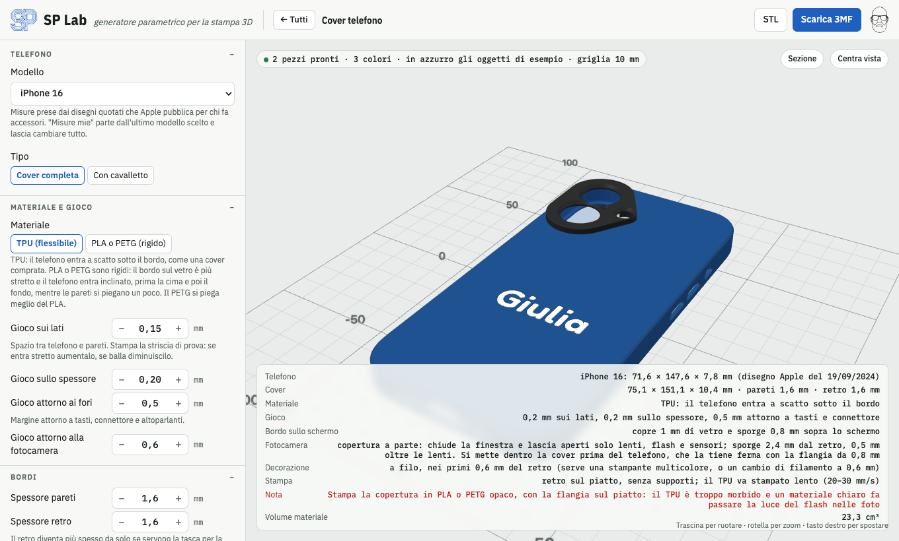

<p align="center"></p>

# SP Lab

**Generatore parametrico per la stampa 3D.**

SP Lab è un generatore parametrico di oggetti da stampare in 3D che funziona interamente nel browser. Scegli cosa vuoi, regoli le misure, guardi l'anteprima 3D e scarichi il file **3MF** (o STL) pronto per lo slicer. Non serve installare niente e non serve internet: è un'unica pagina HTML.


---

## Cosa puoi generare

La pagina iniziale mostra un riquadro per ogni generatore, tre per riga, con la categoria scritta sopra il titolo. Alcuni riquadri raccolgono più generatori, che trovi come schede in alto: Natale (pallina, pallina a spirale, palla piatta, decorazione, albero, stella, lanterna, formina), Gridfinity (contenitore, cassettiera, base), Reggimensole e ganci (reggimensola, gancio), Antivibrazione (tennis, padel) e Viti e bulloni (vite, bullone, perno).

| Generatore | Cos'è | Parti nel file |
|---|---|---|
| **Pallina** | Pallina di Natale sferica, a goccia, a oliva o a cipolla, con decorazioni e scritta | 2 metà, anello, cappuccio, tappo del LED |
| **Pallina a spirale** | Pallina intera che si stampa senza supporti: spicchi a spirale, a V o dritti sopra e sotto, fascia liscia con scritte e simboli traforati, foro per il LED | pallina, cappuccio, tappo |
| **Palla piatta** | Palla di Natale piatta con cappuccio, sfondi (fiocchi, maglione nordico, bosco…), un disegno a colori o il tuo SVG, e il nome, anche su una fascia | 1, più il supporto da tavolo |
| **Decorazione** | Decorazione piatta da appendere con 73 disegni Fluent Emoji a colori (fino a 4 filamenti) o con il tuo SVG, nome su targhetta, oppure solo il nome | 1, più il supporto da tavolo |
| **Albero** | Albero a spirale, a strati o da incastrare, con stella in cima e base con scritta | 1 o 2 |
| **Stella** | Stella 3D a punte, come puntale dell'albero o da appendere | 2 metà |
| **Lanterna** | Lanterna traforata per lumini LED, con scritta | 1 |
| **Formina** | Formina per biscotti con tutti i disegni (anche a forma di nome o dal tuo SVG), con timbro per decorarli | 1 o 2 |
| **Contenitore** | Contenitore [Gridfinity](https://gridfinity.xyz/) impilabile, con divisori, raccordo frontale e ripiano per l'etichetta | 1 |
| **Cassettiera** | Mobiletto Gridfinity con cassetti, impilabile, maniglie a scelta e divisori nei cassetti | mobile + un pezzo per cassetto |
| **Base** | Griglia Gridfinity su cui agganciare contenitori e cassettiere | 1 |
| **Cassetti modulari** | Mattoncini con cassetto che si impilano come i Lego: bottoncini avvitati sopra, gonna cava sotto, cassetto su guide, separatori estraibili; tutto senza supporti | modulo, bottoncini, cassetto, separatori |
| **Rack telefoni** | Rack a fessure per riporre telefoni e tablet, con spessori diversi per ogni fessura | 1 |
| **Cover telefono** | Cover per gli iPhone dal 12 al 17 (misure dei disegni Apple), OnePlus Nord o per qualsiasi telefono con le tue misure: TPU o PLA/PETG a scatto, cavalletto, scritta e il tuo SVG sul retro | 1, più copertura della fotocamera e cavalletto |
| **Vasi** | Vasi per piante aromatiche: tondi, quadrati, esagonali o fioriera a scomparti; normali con sottovaso oppure autoirriganti | da 1 a 5 |
| **Reggimensola** | Squadra per mensole con rinforzo a triangolo (pieno o traforato), puntone, raccordo curvo o arco, viti svasate e labbro antiscivolo | quante ne vuoi |
| **Gancio** | Gancio a muro o appendiabiti con più ganci, sopra porta o anta, per tubo o bastone, a S; fissaggio a viti, biadesivo o magneti | 1 |
| **Powerbank** | Scatola per un powerbank fai-da-te: portapile già pronto (o contatti a molla), cinque schede di ricarica con le porte già al loro posto, coperchio a slitta o a viti nascoste con scritta, loghi e il tuo SVG | scatola e coperchio (anche a colori) |
| **Barattolo** | Barattolo tondo con tappo a vite che si chiude con un giro: cinque misure pronte o le tue, filetto grosso senza supporti, scritta, loghi e il tuo SVG sul tappo | barattolo e tappo (anche a colori) |
| **Supporto tablet** | Cornice con base per usare un tablet senza custodia come schermo di Home Assistant: Fire HD 10 (2021), Fire HD 8 (2018), Fire 7 (2017) o misure tue, orizzontale o verticale | cornice (o 2 metà) e 2 piedini |
| **Antivibrazione tennis** | Antivibrazione per le corde, a bottone (10 forme, i disegni della libreria o il tuo SVG) o a verme, per schemi 16×19, 18×20 o con le tue misure, con una scritta | 1 |
| **Antivibrazione padel** | Tappo per i fori della racchetta, o passante per tutto lo spessore, con una scritta sulla testa | quanti ne vuoi |
| **Vite** | Vite con filetto metrico ISO da M3 a M30 (o misura libera), cinque tipi di testa | 1 |
| **Bullone** | Vite con dado (esagonale, zigrinato o ad alette) e rondelle, già avvitabili tra loro | da 2 a 4 |
| **Perno** | Perno a scatto per unire pezzi stampati, spina liscia o perno con testa e foro per coppiglia | 1, più le piastrine di prova |

### Natale

Tutti gli oggetti di Natale possono avere **fino a tre colori** (abbinamenti pronti oppure colori a scelta) e una **scritta** in tre caratteri: tondo, corsivo e natalizio. Se la scritta non ci sta, viene ridotta da sola e il riquadro misure lo dice.

- **Pallina:** sfera, goccia, oliva o cipolla, liscia o sfaccettata (low poly). Decorazioni: spicchi, anelli, puntini, stelle in rilievo o stelle traforate (con un LED dentro si illumina). Fino a **quattro scritte**, e ognuna la metti dove vuoi: *lato* (0° davanti, 90° a destra, 180° dietro, 270° a sinistra, a passi di 15°), *altezza* (0 = a metà pallina, positivo verso l'alto, negativo verso il basso) e *altezza lettere*. Per esempio il nome davanti, l'anno sotto e una dedica dietro. Le scritte seguono la curva della pallina e possono essere **in rilievo** o **traforate**; le decorazioni si spostano da sole per lasciarle libere. Con le due metà, se una scritta cade sulla giunzione (90° o 270°) il riquadro misure lo segnala.
  - Si stampa in **due metà**, che si incollano su un anello di giunzione: fuori non servono supporti, ma dentro la cupola è a sbalzo e lo slicer può chiederli. Oppure intera, con il supporto.
  - Appendino: **cappuccio** a parte con il foro per il nastro, oppure occhiello.
  - **Luce**, per illuminarla da dentro:
    - *foro per il LED sul fondo*, con diametro regolabile. **Con tappo** per un LED a pila, che si mette e si toglie dal fondo: il tappo ha la faccia piatta, si stampa senza supporti e la pallina ci sta in piedi (con la goccia il tappo è la punta). **Aperto** per spingere dentro una lucina della catena dell'albero. Con le due metà il foro ha due punte a 45°, così il suo bordo si stampa senza supporti;
    - *fessura per il filo* nel cappuccio, per le lucine su filo di rame: i LED entrano dal foro in cima e il filo esce dalla fessura.
- **Pallina a spirale:** pallina vuota che si stampa **intera e senza supporti**, niente incollaggi. Una sfera liscia non ci riesce: sotto le pareti sporgono nel vuoto e dentro la cupola in cima è un soffitto. Qui sopra e sotto la superficie è fatta di **spicchi pieghettati**: ogni faccia della piega resta entro 45° dalla verticale, quindi si regge da sola, fuori e dentro.
  - *Trama:* spirale (verso destra o sinistra), a V (spina di pesce) o spicchi dritti; numero di spicchi e inclinazione della spirale regolabili. La profondità delle pieghe viene calcolata da sola, partendo dai poli, per non superare mai i 45°.
  - *Fascia liscia* a metà pallina: continua tutto intorno, solo attorno a scritte e simboli (gli spicchi continuano con la stessa profondità e resta liscio un riquadro attorno a ognuno), oppure nessuna (spicchi dappertutto). Più la spirale è inclinata e meno sono gli spicchi, più la fascia è stretta: il riquadro misure ne dice l'altezza.
  - *Quattro lati* (davanti, destra, dietro, sinistra): su ognuno una **scritta** o un **simbolo** traforato (stella, cuore, fiocco di neve, albero, campana, luna, pupazzo di neve, regalo, stella cometa, candela, renna). Se non ci stanno nella fascia vengono ridotti da soli. Con un LED dentro si illuminano.
  - *Luce:* foro per il LED al centro del piedino, con diametro regolabile, chiuso da un **tappo** o aperto; fessura nel cappuccio per il filo delle lucine (i LED entrano dal foro in cima).
  - *Colori:* la fascia centrale tutta di un altro colore e/o **righe colorate** orizzontali sopra e sotto (numero e altezza regolabili). I tagli cadono su strati interi da 0,2 mm: con un multicolore sono parti dello stesso oggetto, con un solo colore il riquadro misure dice a che altezza dal piatto cambiare filamento.
  - *Stampa:* poggia su un piedino piatto **piccolo, medio o grande** (Ø 0,3, 0,45 o 0,6 del diametro): piccolo la lascia rotonda, grande è più stabile. **Supporti disattivati del tutto** nello slicer e brim. Lo slicer può avvisare che servono supporti: è normale, perché vede come sbalzo il bordo alto delle lettere (sono ponti) e i solchi interni in cima. Non usare "solo sul piatto": i supporti entrerebbero dal foro del LED e dalle lettere. Verificato con OrcaSlicer (profilo Anycubic Kobra 3) e con una stampa di prova.
- **Palla piatta:** la classica pallina vista di fronte, piatta, con il cappuccio scanalato e l'occhiello. Scrivi il nome (una o due righe, per esempio *Famiglia* e *Rossi 2026*) e componi la palla con due scelte indipendenti, che puoi combinare:
  - **Sfondo**, che riempie la palla attorno al nome: fiocchi di neve, stelle, cuori, pois, righe a bastoncino, spicchi, onde, zig-zag, maglione nordico, ghirlanda sul bordo, oppure una scena (cielo stellato con luna, bosco innevato, paesino con casette, luna con la slitta, regali). *Quantità* e *variante* cambiano quanti elementi ci sono e come sono sparsi; la *fascia dietro il nome* è una striscia che attraversa la palla.
  - **Figura**, un disegno grande sopra il nome, a colori: uno dei disegni Fluent Emoji (pinguino, renna, Babbo Natale…) oppure il tuo SVG, caricato dal riquadro *Il tuo disegno*. Lo sfondo le lascia spazio attorno.
  - Sfondo, figura e scritta hanno **ognuno il suo stile** (come la scritta, in rilievo, a filo, inciso o traforato) e **il suo spessore**: per esempio figura in rilievo su uno sfondo a righe incise, o fiocchi traforati attorno a un nome a filo.
  - Colori, al massimo 4: palla (1), cappuccio, disegni e bordo (2), scritta e dettagli come neve e fiocchi (3), più un quarto colore. I colori della figura vanno sul filamento più simile: quelli uguali alla palla restano del colore della palla.

  
- **Decorazione piatta:** scegli il **motivo** dal menu e scrivi il nome.
  - *Disegni* **Fluent Emoji** di Microsoft (licenza MIT), 73 soggetti: *Natale* (albero, Babbo Natale, Mamma Natale, renna, pupazzo di neve, elfo, angelo, campana, regalo, candela, stelle, slitta, fiocco, biscotto, caramelle, orsetto, matrioske, chiesa, case, cioccolata, luna), *Inverno* (fiocco di neve, nuvola, montagna, abete, guanti, sciarpa, cappotto, calze, sciatore, pattino), *Animali* (pinguino, orso polare, orso, volpe, gufo, gatto, cane, coniglio, riccio, uccellino, colomba) e *Feste* (cuori, quadrifoglio, corona, festa, coriandoli, palloncino, fuochi d'artificio) e *Sport* (racchette, coppa, medaglie, fulmine, fuoco, bicipite, faccine, teschio, razzo, sole, leone, squalo, impronte).
  - *Il tuo disegno:* il riquadro **Il tuo disegno (SVG)**, in cima al pannello, carica un file **SVG** con il pulsante o trascinandolo sopra (forme piene, tratti, gradienti, trasformazioni). Il disegno si usa subito al posto di quello della libreria; *Usa la libreria* torna ai disegni Fluent e *Usa questo* lo riprende. Resta salvato nel browser. C'è anche nella palla piatta e nella formina.
  - *Con il nome:* solo il nome (la decorazione è la scritta stessa, con il contorno che unisce le lettere), medaglione, targhetta. *Forme:* stella a punte, cuore.
  - **Colori, al massimo 4 filamenti:** il colore 1 è il pezzo, poi 2, 3 e 4. Ogni colore del disegno va sul filamento più simile; quelli uguali al colore 1 restano del colore del pezzo. *Colori del disegno* riduce i colori originali a 4 (il più esteso diventa il pezzo). La scritta va sul colore scelto, o in automatico su quello che si legge meglio.
  - **Contorno:** margine attorno alla sagoma che tiene unite le parti vicine; le parti piccole staccate vengono tolte, quelle grandi unite con un ponticello. I dettagli più stretti dell'ugello vengono tolti (il riquadro misure dice quanti).
  - **Nome** su una targhetta sotto o sopra il disegno, oppure sul disegno.
  - In rilievo **tutto il disegno sporge dello stesso spessore**, comprese le parti del colore del pezzo; solo la scritta può essere più alta.
  - **Stile del disegno**, indipendente dalla scritta: *come la scritta*, in rilievo, a filo, inciso o traforato. Inciso e traforato usano la versione a linea dello stesso disegno (Fluent *High Contrast*), che viene molto più pulita; con lo **spessore** regolabile (in rilievo quanto sporgono, a filo e incise quanto entrano; a filo, se è pari allo spessore del pezzo, passano da parte a parte). Traforate: lungo il contorno resta una cornice di 1,2 mm e dei ponticelli tengono le parti che cadrebbero (il riquadro misure dice quanti). Il bordo resta in rilievo o a filo.
  - Scritta **in rilievo**, **a filo** (la superficie resta piana; lo *spessore della scritta* è regolabile in multipli di 0,2 o di 0,28 mm, cioè allineato agli strati anche con il primo strato a 0,28, e se è pari allo spessore del pezzo la scritta lo attraversa e si vede dai due lati), **incisa** o **traforata** (con i ponticelli che tengono l'interno di o, a, e). Occhiello, foro o nessun appendino.

  
  - **Supporto da tavolo** con fessura: diventa un segnaposto.
- **Albero:** a spirale (si può stampare anche in modalità vaso), a strati sfalsati (anche a colori alterni) o da incastrare (due sagome piatte a croce). Stella 3D in cima e base con scritta.
- **Stella 3D:** numero e forma delle punte regolabili. Come **puntale**, con un tubo che si stringe verso l'alto e si adatta alla cima dell'albero, oppure da appendere. Si stampa in due metà piatte.
- **Lanterna** tonda o esagonale, traforata con stelle, fiocchi, alberi o cuori (sagome Fluent Emoji), con la sede per un lumino LED da 38 mm e una scritta sulla fascia in basso, in rilievo o traforata (la luce passa dalle lettere).
- **Formina per biscotti** con tutti i disegni, anche a forma di nome o dal tuo SVG, con lama sottile e bordo per premere. Il **timbro** entra nella formina e stampa le linee del disegno e la scritta sul biscotto (è già a specchio).

#### Scritte: altezza e posizione
- Ogni riga ha la **sua altezza** (*Altezza riga 1*, *Altezza riga 2*): per esempio un nome grande e la data piccola sotto. Nella pallina e nella pallina a spirale ogni scritta ha la sua.
- Sotto ogni riga c'è una **croce di frecce** per spostarla in su, in giù, a destra e a sinistra: 1 mm a clic, 0,2 mm tenendo premuto Maiusc. Il **pulsante al centro** la rimette al centro; accanto c'è di quanto è spostata. Spostandola la scritta non si rimpicciolisce: se esce dal pezzo (o, nella cover, dalla zona libera sotto la fotocamera) la parte fuori viene tagliata e il riquadro misure lo dice. Nella pallina a spirale la scritta sale e scende solo dentro la fascia liscia. Nella pallina le frecce la girano attorno alla sfera (15° a clic) e la alzano o abbassano (5% a clic); il centro la porta a metà altezza.
- Nella palla piatta lo sfondo arriva fino alla scritta, senza un contorno del colore della palla attorno alle lettere e ai loghi.

#### Logo SP
In quasi tutti i generatori con le scritte c'è la sezione **Logo SP** con la voce *Aggiungi logo SP* (spenta all'inizio): mette il marchio SP piccolo, nel carattere Tondo.
- **Misura fissa:** quella che l'ugello scelto stampa pulita con margine, con linee larghe 3 volte l'ugello e spazi 1,5 volte. Con ugello da 0,4 mm è circa 9,2 × 6,1 mm.
- **Solo su superfici piatte**, mai su un fianco curvo o sugli spigoli arrotondati.
- **Nell'angolo in basso**, a destra o a sinistra (voce *Angolo*), nel punto più vicino all'angolo dove ci sta tutto senza toccare scritta, disegni, fori e finestre:
  - parte piatta del retro della cover, vista da fuori; oppure, con *Dove* → *Copertura delle lenti*, sulla faccia esterna della copertura a parte, tra i fori;
  - coperchio del Powerbank;
  - decorazioni e palle piatte;
  - faccia del bottone e fianco del verme negli antivibrazione tennis;
  - testa del tappo padel;
  - albero a incastro, sul pezzo A;
  - formina: sul bordo dove si preme, se è abbastanza largo; con il timbro, inciso sul suo dorso, così non si stampa sui biscotti.
- **Dietro:**
  - albero a spirale o a strati: in rilievo sulla faccia di sopra della base, dietro l'albero (serve la base);
  - lanterna esagonale: in basso sulla faccia dietro;
  - lanterna tonda: sotto il fondo, a filo nel colore della scritta.
- **Pallina e pallina a spirale** non hanno una faccia piatta, quindi lì il logo non c'è.
- Le **frecce** di *Posizione* lo spostano. Ha lo stesso stile della scritta (rilievo, a filo, inciso, traforato). Il **colore** è quello della scritta oppure il 2, il 3 o il 4 (voce *Colore*): nel 3MF il logo è una parte a sé con il suo filamento. Nei pezzi che hanno meno colori (albero, lanterna, formina), il colore in più compare tra i Colori quando lo scegli per il logo. Se non c'è un punto dove sta tutto, va dove ce n'è di più, tagliato dove tocca fori, scritte o il bordo (il riquadro misure lo dice): poi lo sistemi con le frecce.

#### Loghi nelle scritte
In ogni scritta puoi mettere il **viso** e il **viso di Natale** (con cappello da Babbo Natale e barba piena), da soli o insieme al testo: sotto ogni campo di testo ci sono i pulsanti *Viso* e *Viso di Natale*, che inseriscono `{viso}` e `{visoNatale}` dove c'è il cursore (per esempio `{visoNatale} Buon Natale`). Il logo è solo il disegno, senza sfondo: lo sfondo è il colore del pezzo. Il logo SP non va più nelle scritte: c'è la voce *Logo SP* (un `{SP}` nei file salvati prima viene ignorato).
- Il logo è alto 1,35 volte le lettere, quindi lo regoli con l'altezza della sua riga come il resto della scritta, e segue lo stile scelto (rilievo, a filo, incisa, traforata).
- **Ugello:** perché uno slicer stampi davvero le linee di un logo servono almeno **due passate** dell'ugello: con una sola passata molti slicer (Anycubic, Orca e Bambu con le pareti classiche, o con la compensazione del primo strato) le saltano e lì resta il colore sotto. Gli spazi tra le linee devono essere larghi almeno una passata, se no le linee si impastano. Le linee vengono ingrossate verso le due passate finché gli spazi lo permettono; *Minima stampabile* dà l'altezza da cui ci stanno tutte e due le cose. Con ugello da 0,4 mm sono lettere da circa 38,5 mm per il viso di Natale e 52,5 mm per il viso. Più piccolo il logo si genera lo stesso: gli spazi più stretti di una passata vengono chiusi e il riquadro misure avvisa se alcune linee restano sottili.

#### Colori nel file 3MF
- Ogni colore è una **parte separata dello stesso oggetto**: nello slicer (Bambu Studio, OrcaSlicer, PrusaSlicer) assegni un filamento a ciascuna parte. I colori scelti sono anche scritti nel file, e a ogni parte è già assegnato il suo filamento (1, 2, 3…) nei file di configurazione di Bambu Studio / OrcaSlicer e di PrusaSlicer: nello slicer servono almeno tanti filamenti quanti sono i colori, altrimenti la scritta a filo ha lo stesso filamento del resto e non si vede.
- **Stampante a un colore:** per le decorazioni piatte in rilievo il riquadro misure dice a che altezza cambiare filamento, quando i colori sono ad altezze diverse (per esempio un colore per il disegno e uno, più alto, per la scritta). Più colori alla stessa altezza richiedono una stampante multicolore: il riquadro lo segnala.
- **Al massimo 4 filamenti** per pezzo, compreso quello del pezzo.
- Lo **STL** ha un solo colore: per i colori usa il 3MF.

### Contenitore

- Dimensioni in unità Gridfinity: 42 mm di lato, 7 mm di altezza per unità.
- Bordo impilabile: un contenitore si incastra sopra l'altro.
- Spessore di pareti e fondo, divisori in larghezza e profondità.
- Raccordo curvo sul davanti, per prendere facilmente i pezzi piccoli.
- Ripiano per l'etichetta sulla parete di fondo.
- Fori per magneti e viti M3 sotto i piedini.

### Cassettiera

- Piedini Gridfinity sotto e bordo impilabile sopra: ci impili contenitori o un'altra cassettiera.
- Cassetti in altezza e in larghezza, con gioco regolabile tramite la tolleranza.
- Maniglia: tacca, aletta, pomello o nessuna.
- Divisori dentro i cassetti.
- Nell'anteprima uno slider apre i cassetti.

### Cassetti modulari
- Mattoncini a griglia come i Lego (passo 50 mm di default, larghezza e profondità in unità, altezza libera). Modello nostro, fatto per usare poca plastica e stampare tutto dritto: pareti da 1,4 mm (regolabili da 1,2). Il 4 × 2 di partenza, con cassetto e separatori, usa circa 190 cm³ di plastica.
- Ogni modulo è in due pezzi: la **vaschetta** (fondo, fianchi e schiena, davanti aperto per il cassetto) e il **coperchio**, una piastra con i **bottoncini pieni** stampati sopra, come i Lego. Il coperchio entra fra le pareti e poggia su un battente; si fissa **a scatto** (un dentino sulle pareti si aggancia sul suo bordo smussato) oppure **con la colla**.
- I bottoncini entrano nei fori tondi del fondo del modulo di sopra. Il *gioco dell'incastro* allarga o stringe i fori, i bottoncini non cambiano. I moduli si impilano anche spostati di un'unità.
- Cassetto **senza guide** (scorre sul pavimento, meno plastica) oppure **con le guide sui fianchi** (non si inclina quando lo tiri fuori). Ha gli angoli interni arrotondati e la tacca per le dita.
- Separatori estraibili che scorrono nelle scanalature del cassetto, con una tacca a ogni scanalatura per incrociarsi ovunque; oppure fissi.
- Tutto senza supporti: vaschetta sul fondo, coperchio piatto con i bottoncini in su, cassetto sul fondo, separatori in piano.

### Base

- Griglia di qualsiasi misura.
- Solo telaio (leggera) oppure con fondo pieno.
- Fori per magneti o viti.

### Rack telefoni

- Partenza rapida: telefoni o tablet, in piedi o sdraiati. Poi cambi tutto.
- Numero di fessure, spessore del dispositivo (con la cover) e gioco.
- Spessori diversi per ogni fessura, per esempio `9, 11, 11, 14`.
- Separatori con altezza, spessore e inclinazione regolabili, tacca per le dita e rinforzo curvo alla base.
- Base Gridfinity oppure libera, con incavi per piedini in gomma.
- Orientamento di stampa *in piedi* o *sul fianco*. Sul fianco i separatori sono molto più robusti.
- Nell'anteprima vedi dei dispositivi di esempio in azzurro, che non finiscono nel file.

### Cover telefono

- **Modelli:** tutti gli iPhone dal 12 al 17: 12 mini, 12, 12 Pro, 12 Pro Max, 13 mini, 13, 13 Pro, 13 Pro Max, 14, 14 Plus, 14 Pro, 14 Pro Max, 15, 15 Plus, 15 Pro, 15 Pro Max, 16e, 16, 16 Plus, 16 Pro, 16 Pro Max, 17, 17 Pro, 17 Pro Max e Air. Le misure (corpo, curva degli angoli, profilo del bordo, tasti, fotocamera, connettore, altoparlanti) vengono dai disegni quotati che Apple pubblica per chi progetta accessori. Le poche quote che il disegno non scrive (il raggio del rialzo della fotocamera, dove finisce il rialzo largo dei 17 Pro e dell'Air) sono misurate in scala sul disegno.
- **OnePlus Nord** (il primo, del 2020): OnePlus non pubblica disegni quotati. Ingombri dalla scheda tecnica (158,3 × 73,3 × 8,2 mm); curva degli angoli, isola della fotocamera, flash e tasti misurati in scala sulla foto ufficiale del retro (±0,2 mm); profilo dei bordi, finestra del flash e aperture sul fondo ripresi da una cover già provata sul telefono (con cui isola della fotocamera e tasti coincidono entro 0,3 mm); la sporgenza della fotocamera (1,2 mm) è una stima. Niente fori delle singole lenti: la copertura a parte è un anello attorno all'isola. Prima di stampare tutto conviene la striscia di prova.
- **Misure mie:** per qualsiasi altro telefono. I campi partono dalle misure dell'ultimo modello scelto e puoi cambiare tutto: larghezza, altezza, spessore, raggi di angoli e bordo, tasti (centro dalla cima e lunghezza, per esempio `34/7, 48/11`), fotocamera, connettore e fori sul fondo.
- **Materiale:**
  - *TPU:* il telefono entra a scatto sotto il bordo, che gira tutto attorno.
  - *PLA o PETG:* la cover è rigida ma chiusa tutto attorno come quella in TPU. Il bordo sul vetro è più stretto (0,6 mm) e il telefono entra inclinato: prima la cima sotto il bordo, poi si preme giù il fondo, mentre le pareti si piegano di pochi decimi. Il PETG si piega meglio del PLA.
- **Gioco** sui lati e sullo spessore (cambia da solo quando scegli il materiale), attorno a tasti e connettore e attorno alla fotocamera.
- **Bordi:** spessore di pareti e retro, quanto il bordo copre il vetro e quanto sporge sopra lo schermo; spigoli arrotondati, smussati o vivi.
- **Fotocamera:** le lenti degli iPhone sporgono più del retro di una cover sottile. Per proteggerle c'è una **copertura a parte**: chiude tutta la finestra della fotocamera e lascia aperti solo lenti, flash, microfono e sensori (con i fori svasati a 45°, fuori dal campo delle lenti), e sporge oltre le lenti di 0,5 mm (regolabile). Si infila da dentro la cover prima del telefono: passa nella finestra e il suo bordo largo 1 mm (la flangia) resta in un incavo scavato nel retro, dalla parte del telefono. Fuori non esce perché la finestra è più stretta, dentro la tiene ferma il telefono: niente colla. La flangia si allarga a 55°, così si stampa senza supporti. Si stampa con la faccia esterna sul piatto, come il retro della cover (così ha la stessa trama del piatto), senza supporti, in PLA o PETG opaco (un materiale chiaro fa passare la luce del flash nelle foto), anche di un altro colore. Con "Misure mie" le posizioni delle lenti non sono note e diventa un anello attorno alla fotocamera. In alternativa il *retro più spesso*, spesso quanto sporgono le lenti, senza pezzi in più. Su 17 Pro, 17 Pro Max e Air il rialzo della fotocamera è largo quanto il telefono: con la copertura il retro resta dello spessore scelto e la copertura abbraccia il rialzo, sporgendo fuori come una gobba; senza copertura il rialzo entra in una tasca e il retro, piatto fuori, diventa più spesso.
- **Aperture:** dove ci sono i tasti il fianco è aperto dal retro fino al bordo, come nelle cover in commercio (i tasti vicini, Azione e volume o interruttore e volume, in un'unica apertura): il dito arriva a tutto il tasto. Anche il fondo è aperto per cavo, altoparlante e microfoni, senza toccare gli angoli. Il Camera Control ha un'asola con i 25 mm liberi che chiede Apple. Con il TPU i tasti possono anche essere coperti: la parete si assottiglia sopra il tasto e fuori c'è un rilievo da premere.
- **Cavalletto:** un pezzo a parte che si infila in una guida a coda di rondine scavata nel retro e tiene il telefono in verticale o in orizzontale, con l'inclinazione che vuoi. Si stampa steso sul fianco.
- **Retro:** scritta (anche con `{viso}`), logo SP nell'angolo (o sulla copertura delle lenti) e il tuo disegno SVG, caricato dal riquadro *Il tuo disegno*, *a filo* (a colori nei primi strati, la superficie resta liscia), *inciso* o *traforato*. Scritta e disegno partono sotto la fotocamera, ma con le frecce vanno su tutta la parte piatta del retro (1,5 mm prima che inizi l'arrotondamento dello spigolo): vengono tagliati solo dove toccano la fotocamera, la guida del cavalletto o il MagSafe scavato fuori.
- **MagSafe:** un incavo ad anello per un anello magnetico adesivo (diametri e spessore regolabili, con o senza linguetta di orientamento), centrato sul MagSafe del telefono come nei disegni Apple (sul 17 Pro e sull'Air non è al centro). *Dentro la cover* l'anello resta nascosto tra cover e telefono; *sul retro* resta a vista. Così caricatori e accessori MagSafe si attaccano anche attraverso la cover, e anche sull'iPhone 16e, che ha la ricarica wireless ma non i magneti. Con il cavalletto in verticale la guida va da sola sotto l'anello.
- **Striscia di prova:** solo la cima o solo il fondo (22 mm), per controllare misure e gioco in pochi minuti prima di stampare tutta la cover.
- Il riquadro misure avvisa se le lenti sporgono dalla cover, se il retro supera i 2,1 mm (oltre, Apple non garantisce la ricarica MagSafe) e se il bordo entra nella parte piatta dello schermo.

### Vasi

- **Forme:** tondo, quadrato, esagonale, oppure fioriera rettangolare con scomparti (una pianta per scomparto).
- **Misure:** bocca, altezza, quanto si stringe verso il basso, bordo rinforzato.
- **Vaso normale:** fori di drenaggio, canali di scolo sotto il fondo, sottovaso con rialzi.
- **Vaso autoirrigante:**
  - vaso esterno come riserva d'acqua, con foro di troppo pieno;
  - vaso interno che si appoggia sul bordo, con tubo per riempire;
  - cestello pescante forato, separato, che porta l'acqua alle radici.
- Il programma calcola **litri di terra** e **millilitri di riserva d'acqua**.

### Reggimensole e ganci

Si stampano **sdraiati sul fianco**: gli strati seguono il profilo, così la squadra non si apre e il gancio non si spezza lungo gli strati.

- **Reggimensola:**
  - profondità (sotto la mensola), altezza sul muro, larghezza e spessore;
  - rinforzo a scelta: triangolo pieno (il più robusto), triangolo traforato, puntone diagonale, raccordo curvo, arco, oppure nessuno (squadra a L); l'*estensione* dice quanta parte dei bracci copre;
  - viti al muro e sotto la mensola, diametro e svasatura. I fori vanno solo dove arriva il cacciavite (non dietro il rinforzo): se non c'è spazio il riquadro misure lo dice. Fori a goccia, stampabili senza supporti;
  - *labbro* in punta che non fa scivolare la mensola (comodo per il vetro);
  - *piastra al muro* che può salire sopra la mensola con altre viti al muro (la mensola si appoggia contro la piastra), e può essere più larga della squadra: in quel caso si stampa sulla schiena;
  - numero di copie; nell'anteprima c'è una mensola d'esempio in azzurro.
- **Gancio:**
  - *a muro*: uno o più ganci (appendiabiti) con la distanza tra loro, su una piastra fissata con viti (sopra i ganci, dove arriva il cacciavite), biadesivo o magneti incassati sul retro;
  - *sopra porta o anta*: si aggancia sul bordo della porta; imposti spessore della porta, il ponte sottile che passa nella fessura del telaio e la lunghezza dei due lati;
  - *per tubo o bastone*: anello a scatto sul tubo (diametro e apertura regolabili) e gancio sotto;
  - *a S*: apertura sopra e sotto e lunghezza del gambo;
  - per tutti: larghezza e spessore del gancio, sporgenza, raggio della curva, altezza della punta, inclinazione e pallino in punta;
  - orientamento di stampa sul fianco (robusto) o sulla schiena (comodo per gli appendiabiti lunghi).

### Powerbank
- **Schede**, solo quelle con le misure pubblicate dal venditore. Le posizioni delle porte sono ricavate in scala dalle foto dall'alto, e i fori seguono le misure standard dei connettori con un **gioco** regolabile (0,6 mm per lato):

  | Scheda | Dove si compra | Misure | Porte |
  |---|---|---|---|
  | *18650 LCD 2.4A, 2 USB* | Amazon, AliExpress | 65 × 25 mm (venditore) | 2 USB-A, USB-C, micro-USB davanti, Lightning sul fianco, display, pulsante sul fianco |
  | *IP5328P 18 W QC* | Amazon, AliExpress | 64,6 × 32,3 mm (venditore) | 2 USB-A e USB-C davanti, micro-USB sul fianco, 4 LED |
  | *Doppia USB 1 A + 2,1 A con LCD e torcia* | Amazon, AliExpress | 58 × 27 × 15 mm (venditore) | 2 USB-A e micro-USB sotto la scheda (si monta con l'LCD in su), LED della torcia e pulsante sui fianchi |
  | *SW6106 18 W PD/QC* | AliExpress | 71,5 × 17,9 mm (disegno quotato) | USB-C, USB-A e pulsante davanti, 4 LED sopra |
  | *SW6208 22,5 W PD/QC* | AliExpress | 71,8 × 27 mm (disegno quotato) | micro-USB, USB-C, 2 USB-A davanti, pulsante sul fianco |
- **Pareti uniformi:** l'interno ha gli angoli arrotondati come l'esterno, così la parete è spessa uguale anche sulle curve; le guide della slitta seguono la curva degli angoli, e a destra il coperchio copre gli angoli.
- **Celle:** da 1 a 8 **18650 in parallelo**, *normali* (misure massime della Samsung 35E, 18,55 × 65,25 mm) o *protette* (fino a circa 19 × 70 mm). Il riquadro misure calcola capacità e wattora.
- **Portapile già pronto (scelta iniziale), senza saldare niente sulle celle:** un portapile **in parallelo (3,7 V) con i fili**, di cui scrivi tu **lunghezza, larghezza e altezza** (78 × 40 × 22 mm all'inizio, un portapile nero da 2 posti), quanti ne metti (uno accanto all'altro) e quante celle ha ognuno, per il calcolo della capacità. La scatola li tiene in una cornice con 0,4 mm di gioco per lato, aperta in testa per i fili; con più portapile si uniscono i fili con due morsetti a leva. Deve dire 3,7 V o Parallel: quelli da 7,4 V sono in serie.
- **Contatti a molla, come le pile:** ogni vano ha due fessure per le piastrine a molla da 16 × 16,5 mm (vanno bene anche quelle da 16 × 18,5) che si trovano per i portapile 18650: molla a sinistra (−), piastrina col bottone a destra (+), segnati sul fondo. Le celle si tolgono e si rimettono senza saldare. I fili delle piastrine passano dai fori in fondo alle fessure ai canali laterali, e si uniscono con due morsetti a leva. In alternativa, *pacco saldato*.
- **Posizione e orientamento delle celle:** *dietro la scheda*, *a destra* o *a sinistra*, e in ognuna *parallele alla scheda* (da sinistra a destra) o *perpendicolari* (dal davanti verso il retro): sei combinazioni. Il riquadro misure dà le dimensioni esterne, così si prova e si tiene la scatola più comoda. Di fianco, il lato corto della scheda che guarda le celle resta chiuso: se lì c'è il pulsante o una porta, il riquadro misure lo dice.
- **Spazio per i fili** tra il retro della scheda e le celle (8 mm all'inizio, regolabile): lì passano i fili saldati sulle piazzole B+ e B− e gli eventuali morsetti.
- **Fronte:** fori smussati per le porte e, fuori, un incavo grande quanto la spina che lascia la parete spessa 1 mm, così le spine entrano fino in fondo. Le porte sui fianchi hanno un foro grande quanto la spina.
- **Pulsante:** *linguetta* nella parete che si piega e preme il tasto con un dentino, oppure *foro*.
- **Display e LED:** finestra svasata nel coperchio per il display; sopra i LED il coperchio resta spesso 0,4 mm e la luce passa.
- **Coperchio:** *a slitta* (guide a coda di rondine, tacca per l'unghia) oppure *a viti nascoste*: quattro viti svasate da sotto che si avvitano nel coperchio, sopra non si vede niente. Scatola e coperchio sono un solo guscio arrotondato, con gli spigoli raccordati.
- **Coperchio decorato:** scritta su una o due righe con il **viso** e il **viso di Natale** (pulsanti sotto il campo, come nelle altre scritte), il **logo SP** nell'angolo e il **tuo SVG** dal riquadro *Il tuo disegno*. Va nella zona sopra le celle. Il coperchio si stampa capovolto, quindi come il retro della cover: *a filo* (a colori nei primi strati, fino a 4 filamenti, la superficie resta liscia), *inciso* o *traforato*.
- **Pezzi di prova**, da stampare in pochi minuti prima della scatola: il *fronte* con porte e pulsante, per vedere se la scheda combacia; la *chiusura*, cioè con la slitta gli ultimi 30 mm di guida e un pezzo di coperchio da far scorrere (per regolare la tolleranza), con le viti un angolo con la colonnina e il suo pezzo di coperchio da avvitare.
- Le piazzole B+ e B− della scheda restano da saldare (sono le uniche due saldature).
- Nell'anteprima scheda, celle e piastrine sono in azzurro e non finiscono nel file.
- **Viti stampate:** con *Coperchio → a viti* puoi scegliere *Tipo di viti → Stampate* (M6, M8 o M10, gioco del filetto regolabile): le 4–5 viti escono come pezzo da stampare e il coperchio ha le boccole filettate. La scatola cresce di qualche mm per le colonnine più grosse.
- **Pareti e fondo sottili (solo coperchio a viti):** pareti da 0,8 mm e fondo da 0,8 mm in su; con il coperchio a slitta restano almeno 1,6 e 1,2 mm, perché le guide si scavano nelle pareti (se scrivi meno, il riquadro misure lo dice). Sotto 1,2 mm compare un avviso. Con pareti 1,2 e fondo 1,2 la scatola di default passa da circa 37 a circa 26 g di PLA.

### Box schede ESP
In costruzione, un passo alla volta. Scegli il **processore** e fino a **5 moduli**: stanno in fila sul fondo, ognuno nel suo **alloggio** con le pareti piene alte fino alla faccia di sopra del circuito e dentro un **gradino** lungo il bordo su cui poggia il circuito (sotto resta vuoto per le punte dei piedini e i componenti; il gradino si interrompe sotto le file di piedini; altezza e larghezza si scelgono), tutti con i **piedini in su**. Niente torri.
- **Piedini saldati del processore:** *dal lato dei componenti*, la scheda sta dritta sul gradino; *dal lato opposto*, la scheda è capovolta, i componenti e la USB stanno sotto e il gradino si alza sopra i componenti. La porta USB nella parete sinistra si mette all'altezza giusta; se serve la scheda si alza quanto basta perché la spina non tocchi il tavolo.
- **Altezza interna** scelta da te; un avviso se sopra i piedini non c'è posto per i dupont.
- **Moduli ruotabili:** ogni alloggio si gira di 90°, 180° o 270° (con lui girano i piedini).
- **Prese d'aria** a scelta per il processore e per ogni modulo: fessure da 2 mm nel coperchio sopra la scheda, lontano dalle boccole delle viti.
- **Moduli sotto il coperchio** (display, sensori di luce o d'aria): per ogni modulo scegli *sul fondo* o *sotto il coperchio*, la parete (davanti, dietro o destra) e la posizione lungo la parete. Il modulo sta con i componenti in su e i **piedini in giù**; il circuito poggia su una **mensola** della parete, smussata sotto a 55° (si stampa senza supporti), e su **due gambe** sottili dal fondo con un dentino che lo tiene fermo di lato. Quando chiudi il coperchio, il **bordino** (lungo la parete) e dei **pioli** (sopra le gambe) lo bloccano: si monta e si cabla a coperchio aperto. Nel coperchio c'è la **finestra** sopra il display o il sensore; sopra le saldature dei piedini bordino e pioli sono interrotti, come la mensola sotto le file di piedini. La fila sul fondo si allontana da quella parete quanto serve e i moduli restano lontani dalle colonnine delle viti (la scatola si allarga se serve). Ci sono note se i dupont sotto non ci stanno, se due moduli si sovrappongono, se un LED li tocca o se i piedini sono contro la parete.
- **LED** (fino a 4, da 3 o 5 mm): su qualsiasi parete, scegli la posizione lungo la parete (dal centro) e l'altezza dal fondo. Nella parete c'è il foro; dentro, una **culla a U** che parte dal fondo e regge LED, saldature e dupont per lo **spazio dietro i LED** (25 mm di base, regolabile). Il LED si infila da dentro e la punta resta **a filo della parete**: contro la parete c'è un manicotto con il foro del LED, lungo quanto la testa meno lo spessore della parete, e il collarino ci si appoggia dietro. La scatola si allarga da sola dal lato dei LED (davanti, dietro, destra); sulla parete sinistra c'è il processore, quindi il LED ci sta solo davanti o dietro al suo alloggio. Se la culla tocca un alloggio, una colonnina o un altro LED, o se il foro è vicino alla USB, compare una nota. Per ora niente LED nel coperchio.
- **Coperchio avvitato** con 4 **viti stampate** M6 (o M8, M10) a testa svasata: entrano da sotto il fondo, a filo (svasatura a 55°, senza supporti; se il fondo è più sottile della svasatura sotto le colonnine c'è un rialzo), passano nelle colonnine agli angoli e si avvitano nelle boccole filettate sotto il coperchio. Le viti escono come pezzo a parte, da stampare in piedi con la testa sul piatto. Le misure delle schede sono in `dati/schede-misure.js`.

### Barattolo
Barattolo **tondo** con **tappo a vite**. Scegli la **misura** (Piccolo Ø 50 × 45, Medio Ø 70 × 70, Grande Ø 90 × 100, Alto Ø 70 × 130, Largo Ø 120 × 80 mm) oppure *Misure mie* (Ø 30–200 mm, alta 30–250 mm): sono misure esterne con il tappo chiuso; la capienza è nel riquadro delle misure.
- **Filetto grosso, un giro solo:** un principio, lungo 330°, con le punte che si assottigliano agli estremi così il tappo imbocca da solo. Si regolano il **passo** (6 mm di base: quanto sale il tappo in un giro), la **profondità** (1,6 mm) e il **gioco** (0,4 mm). I fianchi sono a 45°: il barattolo si stampa dritto e il tappo capovolto, senza supporti. Se il passo è troppo piccolo per la profondità scelta, viene alzato da solo (lo dice la nota).
- **Tappo a filo:** il collo è più stretto del corpo di quanto servono filetto e gonna del tappo, così da chiuso il tappo è a filo con il barattolo; dentro, sotto il collo, c'è un raccordo a 45°. Il tappo chiude battendo sull'orlo del collo. *Righe per la presa* sulla gonna (si possono togliere).
- **Tappo decorato:** scritta su due righe (con altezza, posizione e rotazione), i visi nelle scritte, il **logo SP** e **il tuo SVG**, come sul coperchio del Powerbank: **a filo** (a colori, nei primi strati del tappo) o **inciso**. Quello che esce dal cerchio del tappo viene tagliato e compare una nota.

### Supporto tablet
Per usare un tablet **senza custodia** come schermo di Home Assistant. Scegli il **modello** (Fire HD 10 11ª gen. 2021, Fire HD 8 8ª gen. 2018, Fire 7 7ª gen. 2017, con le misure ufficiali) oppure le tue misure, poi **orizzontale o verticale** e l'**inclinazione** (20° di base).
- **Cornice:** abbraccia il tablet con 0,3 mm di gioco per lato e davanti ha i labbri che coprono solo il bordo nero: **sotto, sopra, sinistra e destra si regolano ognuno per conto suo** (3,5 mm di base, 0 = niente labbro; quello del lato aperto non c'è). Si stampa sulla schiena, senza supporti; dietro ha una grande finestra per risparmiare plastica.
- **Lato aperto** (destra, sinistra o sopra): da lì entra il tablet e lì restano liberi presa di ricarica e tasti, che sui Fire stanno tutti su un lato. Mettilo dal lato della presa.
- **Base:** due piedini che si stampano sul fianco; sono un blocco a cui si toglie la forma della cornice inclinata, quindi la cornice ci si incastra (0,25 mm di gioco). Davanti restano sotto lo schermo, dietro fanno da puntello.
- **Più grande del piatto:** scrivi il lato del piatto (250 mm per la Anycubic Kobra S1). Se la cornice non ci sta si divide in due metà unite da due **code di rondine** nella schiena (incastro a puzzle, 0,15 mm di gioco), che si stampano piatte; la schiena passa da 2 a 3 mm.

### Antivibrazione
- **Tennis, bottone:** come quelli in commercio, due dischi uguali, uno davanti e uno dietro le corde, uniti da una parte centrale che si incastra nello spazio tra le due corde verticali centrali, sotto l'ultima orizzontale (la regola ITF lo vuole fuori dall'incrocio delle corde): le corde la stringono di fianco e i due dischi le chiudono in mezzo. È in due pezzi, stampati piatti senza supporti: il disco dietro ha la parte centrale e un perno, il disco davanti (con la scritta) ha sotto la sede in cui il perno scatta. Scegli lo schema corde (16×19: 12,5 mm tra le corde centrali, 18×20: 10,5 mm, oppure *Misura tua*), il calibro della corda e la *Presa*, cioè quanto la parte centrale è più larga dello spazio tra le corde, poi larghezza e spessore dei dischi. I due dischi sono simmetrici rispetto alle corde, con lo smusso a 45° sul bordo di fuori; il perno resta nascosto dentro.
- **Forme** (bottone e testa del tappo padel), dal menu *Forma*:
  - forme semplici: tondo, ovale, esagono, ottagono, quadrato, scudo, goccia, stella, cuore, fiore;
  - tutti i disegni della libreria, con il gruppo **Sport** in cima (racchetta e pallina, racchetta e volano, coppa, medaglie, fulmine, fuoco, bicipite, teschio, leone, squalo…);
  - **il tuo SVG**, caricato nel riquadro sopra il menu.
  Con un disegno la sua sagoma diventa la forma e, con *Colori del disegno sulla faccia*, i suoi colori vanno a filo sulla faccia sui filamenti 2–4 più simili. Se la forma è troppo stretta dove passano le corde viene allargata, o le viene aggiunta una fascia che copre le corde; delle parti staccate resta la più grande.
- **Tennis, verme:** striscia lunga da 60 a 130 mm che appoggia sulle corde verticali, con un tassello ogni due spazi tra le corde che si incastra tra le corde, alla distanza dello schema scelto. La scritta va sul fianco, che ha più spazio.
- **Padel, tappo nel foro:** testa con la scritta e gambo con un dentino che si incastra in un foro della racchetta (i fori sono da 9 a 13 mm: misurali). Il gambo ha un taglio e un foro, così si stringe entrando. Testa tonda o a cuore.
- **Padel, passante:** cilindro cavo lungo quanto lo spessore della racchetta (di solito 38 mm) con due nervature e un colletto sottile con la scritta. Il campo *Quanti* li mette già in coppia: uno per faccia nello stesso punto, in alto per più potenza, verso il manico per più controllo.
- **Una sola scritta**, con i loghi SP e i visi: in rilievo (solo tennis), a filo colorata (nei primi o negli ultimi strati, con il colore 2) o incisa. Se non ci sta viene ridotta e il riquadro lo dice.
- Il riquadro misure dà anche il **peso stimato** in TPU.

### Viti e bulloni

- **Filetto metrico ISO** a passo grosso, da M3 a M30; con *Altro* scegli diametro e passo liberi. Filetto destro o sinistro.
- Il filetto è un'elica vera, non un'approssimazione: vite e dado dello stesso file si avvitano.
- **Gioco filetto** regolabile (0,3 mm all'inizio): è lo spazio tra i fianchi di vite e dado.
- **Lunghezza filettata**: tutta, oppure solo in punta con il resto del gambo liscio.
- **Teste:** esagonale, cilindrica, svasata a 90°, zigrinata da girare a mano, oppure senza testa (grano o barra filettata). Impronta a esagono incassato o a taglio. Le misure della testa sono quelle standard ISO, oppure le scegli tu con *Misure testa su misura* (larghezza o chiave, e altezza).
- **Bullone:** dado esagonale, zigrinato o ad alette, dado alto (×1,5) e da zero a due rondelle. L'anteprima mostra il bullone montato e lo spessore che puoi serrare.
- **Orientamento di stampa:** *in piedi* (testa in basso, filetto più preciso) o *sdraiata*, con un lato piatto per appoggiarla: molto più resistente.

### Perni

- **A scatto:** si infila nel foro e si aggancia da solo con due dentini elastici. Doppio, per unire due pezzi, oppure con testa. Imposti diametro e spessore del pezzo da attraversare; il file è già orientato sdraiato sul lato piatto.
- **Spina liscia** con estremità smussate, per centrare due pezzi.
- **Con testa**, con foro per la coppiglia: per cerniere e snodi.
- Il riquadro misure indica il **foro da fare nei tuoi pezzi** (diametro + tolleranza).
- **Piastrina di prova:** un pezzetto con il foro giusto, per provare l'incastro prima di stampare il progetto vero.

---

## Come si usa

1. Scarica `index.html` e aprilo con un browser (Chrome, Safari, Firefox, Edge). Funziona anche offline.
2. Nella pagina iniziale scegli cosa generare. Con Gridfinity, in alto passi da contenitore a cassettiera a base. **← Tutti** riporta alla pagina iniziale.
3. A sinistra regoli i parametri: l'anteprima si aggiorna subito.
4. Con **Informazioni**, in alto a destra, apri il riquadro con le misure reali (esterno, interno, volumi, avvisi): così non copre l'anteprima. Il numero rosso sul pulsante dice quante note ci sono; **Esc** lo richiude.
5. Dal menu **File**, in alto, **Salva con nome** (⌘S) salva le regolazioni in un file `.json` col nome che scegli in quel momento: su Chrome ed Edge si apre la finestra del Mac, dove scegli anche la cartella; su Safari e Firefox scrivi il nome in una finestrella e il file va in **Download** (per scegliere la cartella: Safari › Impostazioni › Generali › Posizione dei download › Chiedi per ogni download). **Apri** (⌘O) ricarica un file salvato, anche di un altro generatore o da un altro computer. Il nome del file aperto o salvato si vede accanto a **File**.
6. Premi **Scarica 3MF**, oppure **STL**, e apri il file nello slicer.

**Comandi dell'anteprima**
- Trascina per ruotare, rotella per lo zoom, tasto destro per spostare.
- **Sezione** taglia il modello a metà per vedere com'è fatto dentro.
- **Centra vista** riporta la camera sul modello.

I valori che imposti restano salvati nel browser. **Ripristina valori** torna a quelli iniziali.

**Se l'anteprima 3D non compare:** l'anteprima usa WebGL, la grafica 3D del browser. Su alcuni PC non è disponibile (scheda video vecchia, driver da aggiornare, accelerazione grafica disattivata, PC aziendali). Il sito funziona lo stesso: schede, parametri, misure ed esportazione ci sono, al posto delle anteprime compare un avviso. Per riaverle, in Chrome o Edge attiva *Impostazioni → Sistema → Usa l'accelerazione grafica se disponibile* e riavvia il browser, oppure prova un altro browser.

**Frecce di posizione:** sotto ogni croce di frecce scegli il passo, 0,5 · 1 · 5 · 10 mm a clic (vale per tutte le croci; con Maiusc 0,2 mm).

**Link diretti:** ogni generatore ha il suo indirizzo, da usare per linkarlo o salvarlo nei preferiti: `#natale` (pallina), `#natale-palla` (palla piatta), `#natale-piatto`, `#natale-albero`, `#natale-stella`, `#natale-lanterna`, `#natale-formina`, `#gridfinity`, `#gridfinity-cab` (cassettiera), `#gridfinity-base`, `#rack`, `#vasi`, `#supporti` (reggimensola), `#supporti-gancio`, `#racchette` (antivibrazione tennis), `#racchette-padel`, `#powerbank`, `#viteria` (vite), `#viteria-bullone`, `#viteria-perno`, `#cover`.

### Il file 3MF
- Ogni pezzo è un oggetto separato e con il suo nome (per esempio "Cassetto 3" o "Cestello pescante 1").
- Le parti di colori diversi dello stesso pezzo restano unite in un solo oggetto multicolore.
- I pezzi sono già disposti sul piatto e orientati per la stampa senza supporti: coperchi e cestelli capovolti, cassetti accanto al mobile, viti con la testa in basso o sdraiate sul lato piatto, dadi e rondelle accanto.
- Il riquadro misure separa le **Note** in rosso (c'è qualcosa da cambiare, con il suggerimento) dalle **Info** neutre (solo informazioni, niente da correggere).
- Funziona con Bambu Studio, PrusaSlicer, OrcaSlicer, Cura e gli altri slicer che leggono il 3MF.

---

## Consigli di stampa

### Tarare la tolleranza
Ogni stampante è diversa. Il parametro **Tolleranza stampante** (0,3 mm all'inizio) è il gioco usato negli incastri: cassetti, fori per magneti, vaso interno e cestello.
1. Stampa un pezzo piccolo, per esempio una cassettiera 1×2 con un cassetto.
2. Se il cassetto entra troppo stretto, aumenta la tolleranza di 0,05–0,1 mm.
3. Se balla troppo, diminuiscila.

### Per tipo di oggetto
- **Decorazioni piatte e palle piatte:** strati da 0,2 mm, 3 mm di spessore. Spessore, spessore della scritta e rilievo vanno a multipli di 0,2 e di 0,28 mm (0,28 · 0,56 · 0,84 · 1,12…): con − e + si passa al valore vicino, così ogni colore cade su strati interi anche se stampi il primo strato a 0,28. Per scritte piccole ugello da 0,4 mm e lettere di almeno 5 mm. La scritta in corsivo regge meglio se è almeno 8 mm.
- **Palline:** incolla le due metà sull'anello con colla cianoacrilica. Lo spessore del guscio va bene da 1,2 mm in su; con 0,8 mm la pallina è leggerissima ma delicata.
- **Formine:** usa PLA o PETG adatti agli alimenti e lavale a mano.
- **Lanterne:** solo lumini LED, mai candele vere.
- **Gridfinity:** per la prima prova stampa un contenitore 1×1×3 e una base 2×2, così verifichi incastro e impilamento.
- **Pareti:** usa spessori multipli del diametro dell'ugello (con 0,4 mm: 0,8, 1,2, 1,6).
- **Rack:** se i separatori sono alti o sottili, stampalo *sul fianco*.
- **Cover:** stampa prima la striscia di prova e regola il gioco. TPU (95A) lento, 20–30 mm/s, senza supporti; con PLA o PETG parti da 0,3 mm di gioco. Cavalletto e copertura della fotocamera vanno stampati in PLA o PETG; se la copertura entra dura nella finestra aumenta il suo gioco.
- **Vasi:** perché tengano l'acqua servono almeno 3 perimetri. Per il vaso esterno dell'autoirrigante e per il sottovaso, il PETG è meglio del PLA.
- **Reggimensole e ganci:** lasciali sul fianco come escono dal file. 4 o più perimetri e riempimento 40% o più; per pesi veri PETG. Per libri usa squadre da 7 mm di spessore e 25 mm di larghezza in su, con il rinforzo a triangolo pieno.
- **Viti e bulloni:** stampa prima un bullone M8 corto per tarare il *Gioco filetto*. Usa 4 o più perimetri (o riempimento 100%) e strati sottili (0,12–0,16 mm). Sotto M6 il filetto stampato è delicato. Per viti che lavorano, PETG o nylon.
- **Powerbank:** PETG o ASA, non PLA (in auto al sole si deforma). Stampa prima la *prova del fronte*. Prima di collegare le celle in parallelo portale alla stessa tensione e rispetta la polarità sulle piazzole B+ e B−: al contrario la scheda si brucia.
- **Antivibrazione:** TPU morbido (85A–95A) o TPE: più è morbido più smorza, il PLA non smorza. 20 mm/s, 3 pareti, riempimento gyroid 30–50% (meno riempimento = più morbido), brim perché il TPU tende a sollevarsi. Stampa prima un pezzo e prova l'incastro: se scivola aumenta la *Presa*, se non entra diminuiscila.
- **Perni a scatto:** se il perno entra troppo duro aumenta la tolleranza; se la fessura è corta (lo segnala il riquadro misure) il perno resta rigido.

---

## Per sviluppatori

### Struttura

```
├── index.html      pagina finale (generata, non modificarla a mano)
├── build.py        unisce sorgenti e librerie in index.html
├── package.json    librerie: three.js e manifold-3d
├── src/
│   ├── page.html   interfaccia e stili
│   ├── app.js      parametri, anteprima 3D, esportazione 3MF/STL
│   ├── geom.js     geometria dei generatori (filetti compresi)
│   ├── natale.js   generatori di Natale: forme, scritte, colori
│   ├── supporti.js reggimensole e ganci
│   ├── cover.js    cover per telefoni
│   ├── telefoni.js misure dei telefoni per le cover
│   ├── powerbank.js scatola per powerbank: celle, schede e connettori
│   ├── racchette.js antivibrazione per racchette da tennis e padel
│   ├── cassetti.js cassetti modulari a mattoncino
│   ├── barattolo.js barattoli tondi con tappo a vite
│   ├── fonts.js    contorni dei caratteri (generato)
│   ├── logos.js    contorni dei loghi per le scritte (generato da assets/)
│   ├── svg.js      lettore SVG (disegni caricati e libreria)
│   └── emoji.js    disegni Fluent Emoji (generato)
├── assets/         loghi: SVG per la pagina (li incorpora build.py) e STL originali
├── tools/
│   ├── make-fonts.mjs  rigenera src/fonts.js dai caratteri
│   ├── make-logos.mjs  rigenera src/logos.js dagli STL dei loghi
│   └── make-emoji.mjs  rigenera src/emoji.js dai Fluent Emoji
└── docs/img/       immagini per questo README
```

### Ricostruire `index.html`

```bash
npm install
python3 build.py
```

Lo script incorpora three.js, Manifold (compreso il file WebAssembly), i caratteri e i sorgenti in un solo HTML da circa 1,8 MB, che funziona offline.

Per cambiare i caratteri delle scritte modifica l'elenco in `tools/make-fonts.mjs` e lancia `npm run fonts`. Per cambiare i loghi sostituisci gli STL e gli SVG in `assets/` e lancia `npm run logos`. Per aggiungere o togliere disegni dalla libreria modifica l'elenco in `tools/make-emoji.mjs` e lancia `npm run emoji`.

### Come funziona
- **Geometria:** [Manifold](https://github.com/elalish/manifold) (WebAssembly) costruisce solidi con operazioni booleane. I modelli escono sempre chiusi e senza errori.
- **Scritte:** i contorni dei caratteri sono salvati in `src/fonts.js`; al momento le curve diventano poligoni e poi solidi.
- **Colori:** un generatore può dare a ogni parte un `color` e un `group`. Le parti dello stesso gruppo diventano un solo oggetto con più parti (componenti 3MF), e i colori finiscono nei materiali del file.
- **Filetti:** la sezione trasversale del profilo ISO a 60° viene estrusa con una torsione di 360° per ogni passo, e ne esce un'elica esatta. Il foro del dado usa la stessa sezione allargata del gioco, con la stessa fase: per questo vite e dado combaciano.
- **Anteprima:** [three.js](https://threejs.org/).
- **Esportazione:** il 3MF è un file zip con dentro XML, scritto direttamente dal codice senza librerie esterne.

### Aggiungere un generatore
1. In `src/geom.js` scrivi una funzione `nome(p)` che riceve i parametri e restituisce quanto segue. Per un gruppo grande puoi usare un file a parte che si registra in `SPRECOLO_EXT`, come `src/natale.js`, e aggiungerlo a `build.py`.
   - `parts`: lista di `{ name, m, role, print?, at?, color?, group? }`
     - `m` è il solido Manifold;
     - `print` è la versione già orientata per la stampa;
     - `at` è la posizione nell'anteprima;
     - `role: 'ghost'` indica un oggetto solo di esempio, che non viene esportato.
     - `color` (es. `'#b3202a'`) e `group`: le parti con lo stesso gruppo diventano un unico oggetto multicolore.
   - `info`: lista di coppie `[etichetta, valore]` per il riquadro delle misure.
2. Collegala in `build()` dentro `geom.js`.
3. In `src/app.js` aggiungi una voce in `MODES` con l'elenco dei parametri: tipo `int`, `num`, `bool`, `select` o `text`, con `min`, `max`, `step`, `def`, `unit`, `help` e `show`.
4. Sempre in `src/app.js`, aggiungi il generatore a `GROUPS`: un nuovo gruppo diventa un nuovo riquadro nella pagina iniziale, con titolo, categoria e descrizione. Puoi anche aggiungerlo a un gruppo esistente, che mostra le sotto-schede in alto. L'anteprima del riquadro viene generata in automatico dal motore.
5. Esegui `python3 build.py`.

---

## Crediti

- **Gridfinity**, il sistema modulare creato da [Zack Freedman](https://www.youtube.com/@ZackFreedman). SP Lab ne riproduce le misure standard.
- **[three.js](https://github.com/mrdoob/three.js)**, licenza MIT.
- **[Manifold](https://github.com/elalish/manifold)**, licenza Apache 2.0.
- Caratteri **IBM Plex**, licenza SIL Open Font License (caricati da Google Fonts quando c'è connessione).
- Caratteri delle scritte **Fredoka**, **Pacifico** e **Mountains of Christmas**, licenza SIL Open Font License, incorporati nella pagina.

- Disegni **[Fluent Emoji](https://github.com/microsoft/fluentui-emoji)** © Microsoft Corporation, licenza MIT (testo completo in [LICENSE-fluent-emoji.txt](LICENSE-fluent-emoji.txt), riportato anche dentro la pagina).
- Misure del OnePlus Nord dalla scheda tecnica e dalla foto del retro su oneplus.com. OnePlus è un marchio di OnePlus Technology; SP Lab non è collegato a OnePlus.
- Misure degli iPhone dai disegni quotati di Apple (*Accessory Design Guidelines*, developer.apple.com). iPhone è un marchio di Apple Inc.; SP Lab non è collegato ad Apple.
- Loghi **SP** e ritratto © Procolo Carannante.

## Licenza

Distribuito con licenza [MIT](LICENSE) © 2026 Procolo Carannante: chiunque può usare e modificare il progetto citando l'autore.

## Sito pubblico

Il generatore è online su **https://procolo75.github.io/sp-lab/**
