<p align="center"></p>

# SP Lab

**Generatore parametrico per la stampa 3D.**

SP Lab è un generatore parametrico di oggetti da stampare in 3D che funziona interamente nel browser. Scegli cosa vuoi, regoli le misure, guardi l'anteprima 3D e scarichi il file **3MF** (o STL) pronto per lo slicer. Non serve installare niente e non serve internet: è un'unica pagina HTML.

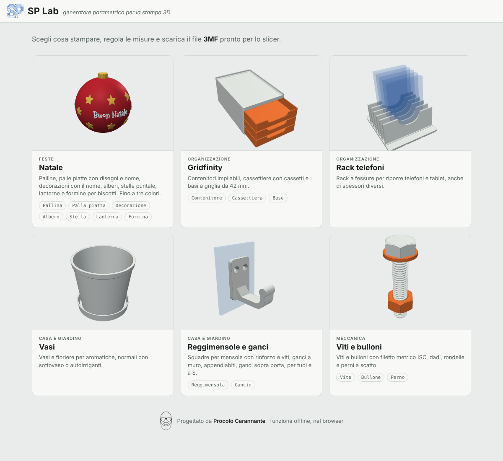

---

## Cosa puoi generare

La pagina iniziale mostra un riquadro per ogni generatore, tre per riga, con la categoria scritta sopra il titolo. Alcuni riquadri raccolgono più generatori, che trovi come schede in alto: Natale (pallina, palla piatta, decorazione, albero, stella, lanterna, formina), Gridfinity (contenitore, cassettiera, base), Reggimensole e ganci (reggimensola, gancio) e Viti e bulloni (vite, bullone, perno).

| Generatore | Cos'è | Parti nel file |
|---|---|---|
| **Pallina** | Pallina di Natale sferica, a goccia, a oliva o a cipolla, con decorazioni e scritta | 2 metà, anello, cappuccio |
| **Palla piatta** | Palla di Natale piatta con cappuccio, sfondi (fiocchi, maglione nordico, bosco…), un disegno a colori o il tuo SVG, e il nome, anche su una fascia | 1, più il supporto da tavolo |
| **Decorazione** | Decorazione piatta da appendere con 57 disegni Fluent Emoji a colori (fino a 4 filamenti) o con il tuo SVG, nome su targhetta, oppure solo il nome | 1, più il supporto da tavolo |
| **Albero** | Albero a spirale, a strati o da incastrare, con stella in cima e base con scritta | 1 o 2 |
| **Stella** | Stella 3D a punte, come puntale dell'albero o da appendere | 2 metà |
| **Lanterna** | Lanterna traforata per lumini LED, con scritta | 1 |
| **Formina** | Formina per biscotti con tutti i disegni (anche a forma di nome o dal tuo SVG), con timbro per decorarli | 1 o 2 |
| **Contenitore** | Contenitore [Gridfinity](https://gridfinity.xyz/) impilabile, con divisori, raccordo frontale e ripiano per l'etichetta | 1 |
| **Cassettiera** | Mobiletto Gridfinity con cassetti, impilabile, maniglie a scelta e divisori nei cassetti | mobile + un pezzo per cassetto |
| **Base** | Griglia Gridfinity su cui agganciare contenitori e cassettiere | 1 |
| **Rack telefoni** | Rack a fessure per riporre telefoni e tablet, con spessori diversi per ogni fessura | 1 |
| **Vasi** | Vasi per piante aromatiche: tondi, quadrati, esagonali o fioriera a scomparti; normali con sottovaso oppure autoirriganti | da 1 a 5 |
| **Reggimensola** | Squadra per mensole con rinforzo a triangolo (pieno o traforato), puntone, raccordo curvo o arco, viti svasate e labbro antiscivolo | quante ne vuoi |
| **Gancio** | Gancio a muro o appendiabiti con più ganci, sopra porta o anta, per tubo o bastone, a S; fissaggio a viti, biadesivo o magneti | 1 |
| **Vite** | Vite con filetto metrico ISO da M3 a M30 (o misura libera), cinque tipi di testa | 1 |
| **Bullone** | Vite con dado (esagonale, zigrinato o ad alette) e rondelle, già avvitabili tra loro | da 2 a 4 |
| **Perno** | Perno a scatto per unire pezzi stampati, spina liscia o perno con testa e foro per coppiglia | 1, più le piastrine di prova |

### Natale
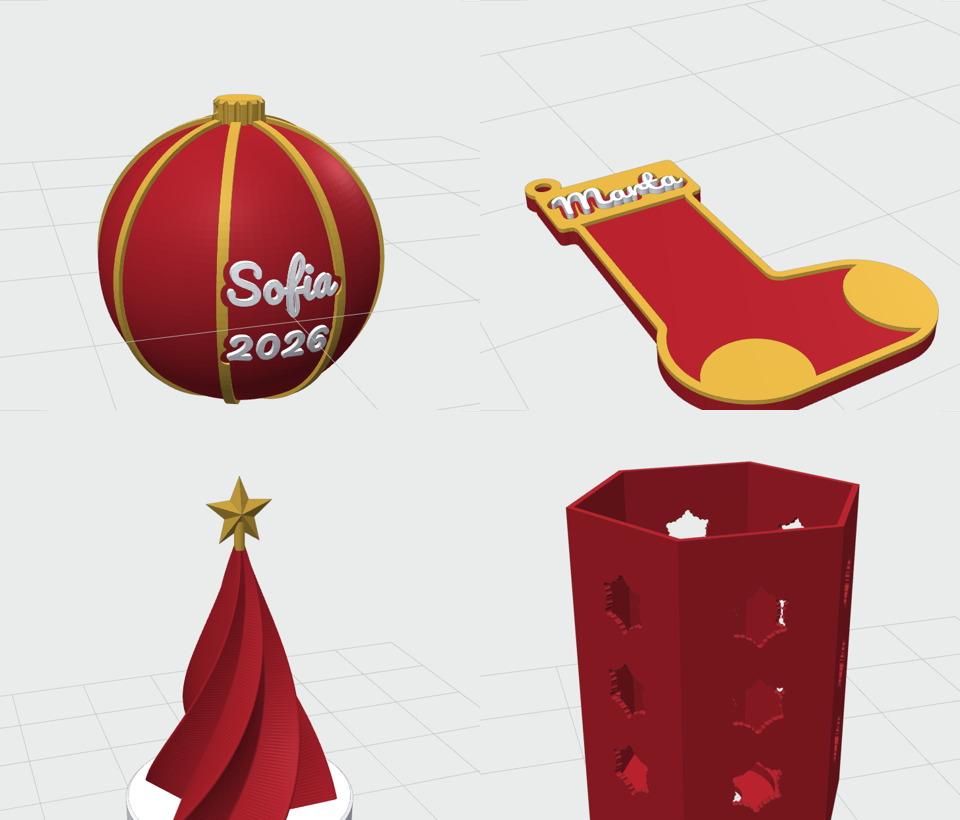
Tutti gli oggetti di Natale possono avere **fino a tre colori** (abbinamenti pronti oppure colori a scelta) e una **scritta** in tre caratteri: tondo, corsivo e natalizio. Se la scritta non ci sta, viene ridotta da sola e il riquadro misure lo dice.

- **Pallina:** sfera, goccia, oliva o cipolla, liscia o sfaccettata (low poly). Decorazioni: spicchi, anelli, puntini, stelle in rilievo o stelle traforate (con un LED dentro si illumina). Fino a **quattro scritte**, e ognuna la metti dove vuoi: *lato* (0° davanti, 90° a destra, 180° dietro, 270° a sinistra, a passi di 15°), *altezza* (0 = a metà pallina, positivo verso l'alto, negativo verso il basso) e *altezza lettere*. Per esempio il nome davanti, l'anno sotto e una dedica dietro. Le scritte seguono la curva della pallina e possono essere **in rilievo** o **traforate**; le decorazioni si spostano da sole per lasciarle libere. Con le due metà, se una scritta cade sulla giunzione (90° o 270°) il riquadro misure lo segnala.
  - Si stampa in **due metà** senza supporti, che si incollano su un anello di giunzione. Oppure intera, con il supporto.
  - Appendino: **cappuccio** a parte con il foro per il nastro, oppure occhiello.
- **Palla piatta:** la classica pallina vista di fronte, piatta, con il cappuccio scanalato e l'occhiello. Scrivi il nome (una o due righe, per esempio *Famiglia* e *Rossi 2026*) e componi la palla con due scelte indipendenti, che puoi combinare:
  - **Sfondo**, che riempie la palla attorno al nome: fiocchi di neve, stelle, cuori, pois, righe a bastoncino, spicchi, onde, zig-zag, maglione nordico, ghirlanda sul bordo, oppure una scena (cielo stellato con luna, bosco innevato, paesino con casette, luna con la slitta, regali). *Quantità* e *variante* cambiano quanti elementi ci sono e come sono sparsi; la *fascia dietro il nome* è una striscia che attraversa la palla.
  - **Figura**, un disegno grande sopra il nome, a colori: uno dei disegni Fluent Emoji (pinguino, renna, Babbo Natale…) oppure il tuo SVG, caricato dal riquadro *Il tuo disegno*. Lo sfondo le lascia spazio attorno.
  - Sfondo, figura e scritta hanno **ognuno il suo stile** (come la scritta, in rilievo, a filo, inciso o traforato) e **il suo spessore**: per esempio figura in rilievo su uno sfondo a righe incise, o fiocchi traforati attorno a un nome a filo.
  - Colori, al massimo 4: palla (1), cappuccio, disegni e bordo (2), scritta e dettagli come neve e fiocchi (3), più un quarto colore. I colori della figura vanno sul filamento più simile: quelli uguali alla palla restano del colore della palla.

  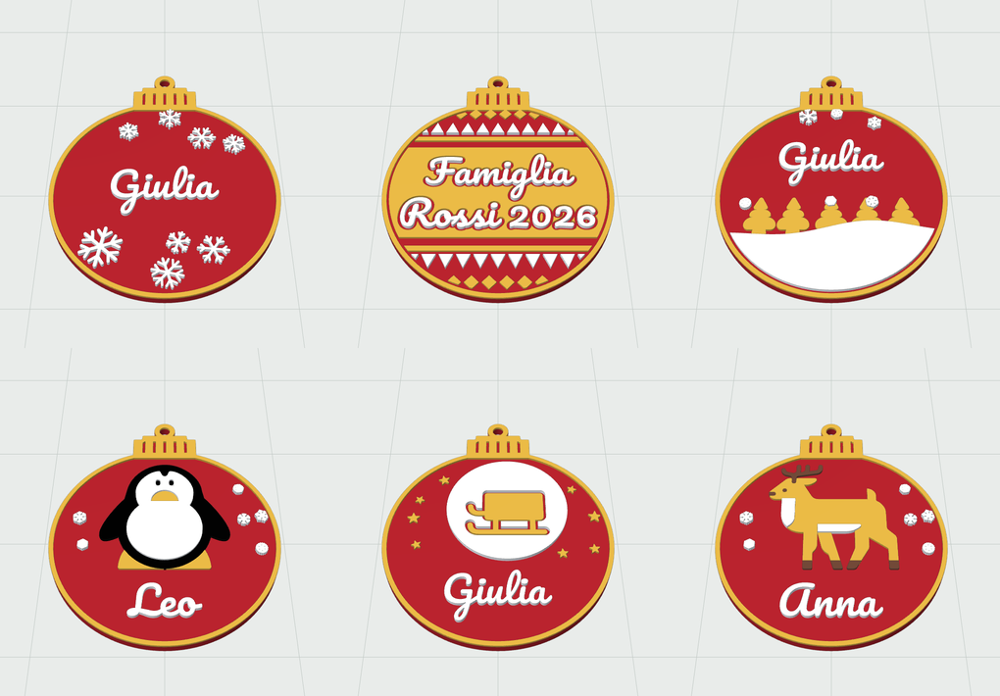
- **Decorazione piatta:** scegli il **motivo** dal menu e scrivi il nome.
  - *Disegni* **Fluent Emoji** di Microsoft (licenza MIT), 57 soggetti: *Natale* (albero, Babbo Natale, Mamma Natale, renna, pupazzo di neve, elfo, angelo, campana, regalo, candela, stelle, slitta, fiocco, biscotto, caramelle, orsetto, matrioske, chiesa, case, cioccolata, luna), *Inverno* (fiocco di neve, nuvola, montagna, abete, guanti, sciarpa, cappotto, calze, sciatore, pattino), *Animali* (pinguino, orso polare, orso, volpe, gufo, gatto, cane, coniglio, riccio, uccellino, colomba) e *Feste* (cuori, quadrifoglio, corona, festa, coriandoli, palloncino, fuochi d'artificio).
  - *Il tuo disegno:* il riquadro **Il tuo disegno (SVG)**, in cima al pannello, carica un file **SVG** con il pulsante o trascinandolo sopra (forme piene, tratti, gradienti, trasformazioni). Il disegno si usa subito al posto di quello della libreria; *Usa la libreria* torna ai disegni Fluent e *Usa questo* lo riprende. Resta salvato nel browser. C'è anche nella palla piatta e nella formina.
  - *Con il nome:* solo il nome (la decorazione è la scritta stessa, con il contorno che unisce le lettere), medaglione, targhetta. *Forme:* stella a punte, cuore.
  - **Colori, al massimo 4 filamenti:** il colore 1 è il pezzo, poi 2, 3 e 4. Ogni colore del disegno va sul filamento più simile; quelli uguali al colore 1 restano del colore del pezzo. *Colori del disegno* riduce i colori originali a 4 (il più esteso diventa il pezzo). La scritta va sul colore scelto, o in automatico su quello che si legge meglio.
  - **Contorno:** margine attorno alla sagoma che tiene unite le parti vicine; le parti piccole staccate vengono tolte, quelle grandi unite con un ponticello. I dettagli più stretti dell'ugello vengono tolti (il riquadro misure dice quanti).
  - **Nome** su una targhetta sotto o sopra il disegno, oppure sul disegno.
  - In rilievo **tutto il disegno sporge dello stesso spessore**, comprese le parti del colore del pezzo; solo la scritta può essere più alta.
  - **Stile del disegno**, indipendente dalla scritta: *come la scritta*, in rilievo, a filo, inciso o traforato. Inciso e traforato usano la versione a linea dello stesso disegno (Fluent *High Contrast*), che viene molto più pulita; con lo **spessore** regolabile (in rilievo quanto sporgono, a filo e incise quanto entrano; a filo, se è pari allo spessore del pezzo, passano da parte a parte). Traforate: lungo il contorno resta una cornice di 1,2 mm e dei ponticelli tengono le parti che cadrebbero (il riquadro misure dice quanti). Il bordo resta in rilievo o a filo.
  - Scritta **in rilievo**, **a filo** (la superficie resta piana; lo *spessore della scritta* è regolabile in multipli di 0,2 o di 0,28 mm, cioè allineato agli strati anche con il primo strato a 0,28, e se è pari allo spessore del pezzo la scritta lo attraversa e si vede dai due lati), **incisa** o **traforata** (con i ponticelli che tengono l'interno di o, a, e). Occhiello, foro o nessun appendino.

  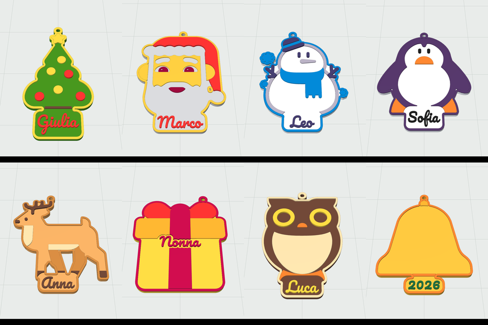
  - **Supporto da tavolo** con fessura: diventa un segnaposto.
- **Albero:** a spirale (si può stampare anche in modalità vaso), a strati sfalsati (anche a colori alterni) o da incastrare (due sagome piatte a croce). Stella 3D in cima e base con scritta.
- **Stella 3D:** numero e forma delle punte regolabili. Come **puntale**, con un tubo che si stringe verso l'alto e si adatta alla cima dell'albero, oppure da appendere. Si stampa in due metà piatte.
- **Lanterna** tonda o esagonale, traforata con stelle, fiocchi, alberi o cuori (sagome Fluent Emoji), con la sede per un lumino LED da 38 mm e una scritta sulla fascia in basso, in rilievo o traforata (la luce passa dalle lettere).
- **Formina per biscotti** con tutti i disegni, anche a forma di nome o dal tuo SVG, con lama sottile e bordo per premere. Il **timbro** entra nella formina e stampa le linee del disegno e la scritta sul biscotto (è già a specchio).

#### Loghi nelle scritte
In ogni scritta puoi mettere il **logo SP** e il **viso**, da soli o insieme al testo: sotto ogni campo di testo ci sono i pulsanti *Logo SP* e *Viso*, che inseriscono `{SP}` e `{viso}` dove c'è il cursore (per esempio `{SP} Lab` o `{viso} Giulia`).
- Il logo è alto 1,35 volte le lettere, quindi lo regoli con *Altezza lettere* come il resto della scritta, e segue lo stile scelto (rilievo, a filo, incisa, traforata).
- **Ugello:** le linee dei loghi sono sottili (0,86 mm nel logo SP alto 46 mm, 0,70 mm nel viso alto 58 mm). Se il logo è più piccolo, le linee vengono ingrossate fino alla larghezza dell'ugello scelto (0,2 · 0,4 · 0,6 · 0,8 mm), così si stampano comunque. Il riquadro misure dice di quanto e da che altezza in su il logo esce con tutti i dettagli: con ugello da 0,4 mm circa 23 mm per il logo SP e 36 mm per il viso.

#### Colori nel file 3MF
- Ogni colore è una **parte separata dello stesso oggetto**: nello slicer (Bambu Studio, OrcaSlicer, PrusaSlicer) assegni un filamento a ciascuna parte. I colori scelti sono anche scritti nel file.
- **Stampante a un colore:** per le decorazioni piatte in rilievo il riquadro misure dice a che altezza cambiare filamento, quando i colori sono ad altezze diverse (per esempio un colore per il disegno e uno, più alto, per la scritta). Più colori alla stessa altezza richiedono una stampante multicolore: il riquadro lo segnala.
- **Al massimo 4 filamenti** per pezzo, compreso quello del pezzo.
- Lo **STL** ha un solo colore: per i colori usa il 3MF.

### Contenitore
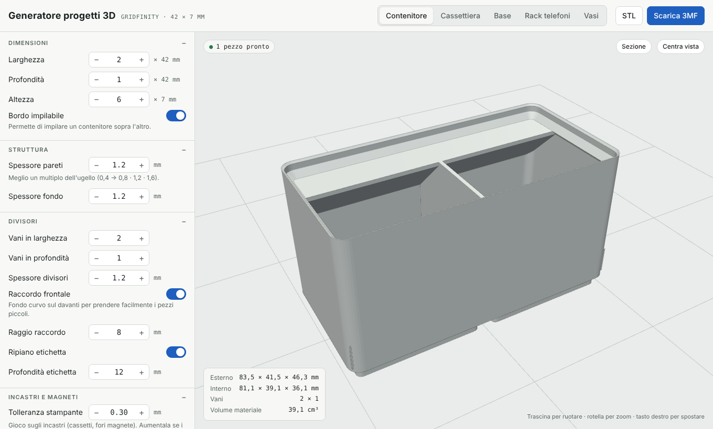
- Dimensioni in unità Gridfinity: 42 mm di lato, 7 mm di altezza per unità.
- Bordo impilabile: un contenitore si incastra sopra l'altro.
- Spessore di pareti e fondo, divisori in larghezza e profondità.
- Raccordo curvo sul davanti, per prendere facilmente i pezzi piccoli.
- Ripiano per l'etichetta sulla parete di fondo.
- Fori per magneti e viti M3 sotto i piedini.

### Cassettiera
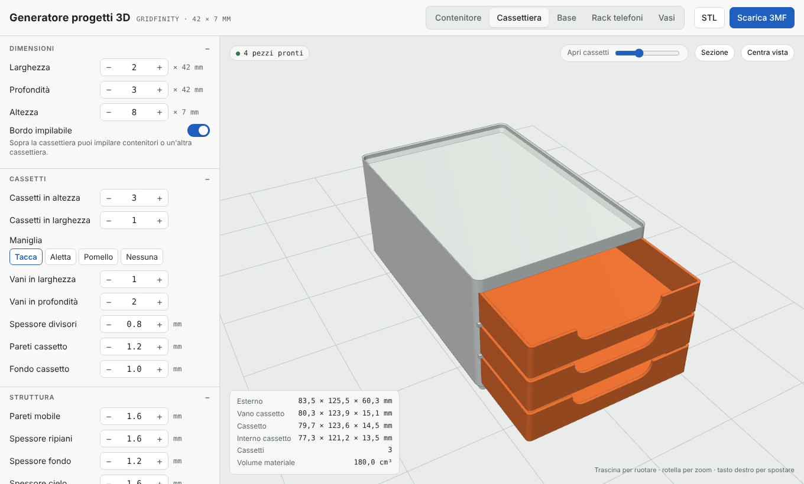
- Piedini Gridfinity sotto e bordo impilabile sopra: ci impili contenitori o un'altra cassettiera.
- Cassetti in altezza e in larghezza, con gioco regolabile tramite la tolleranza.
- Maniglia: tacca, aletta, pomello o nessuna.
- Divisori dentro i cassetti.
- Nell'anteprima uno slider apre i cassetti.

### Base
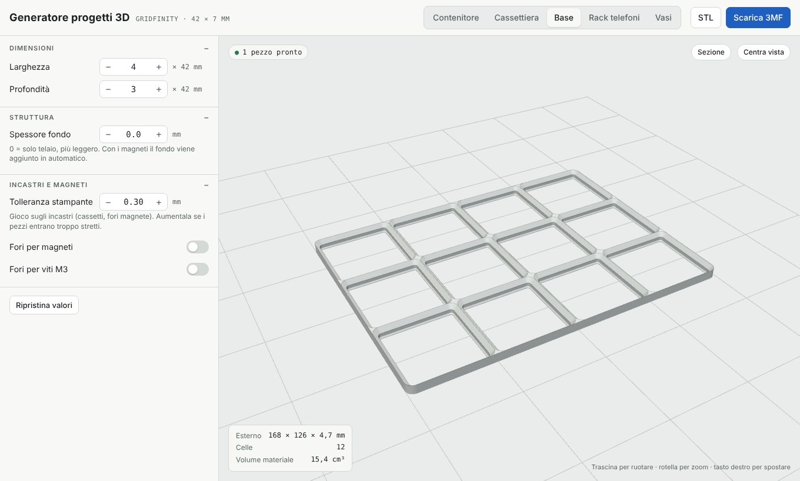
- Griglia di qualsiasi misura.
- Solo telaio (leggera) oppure con fondo pieno.
- Fori per magneti o viti.

### Rack telefoni
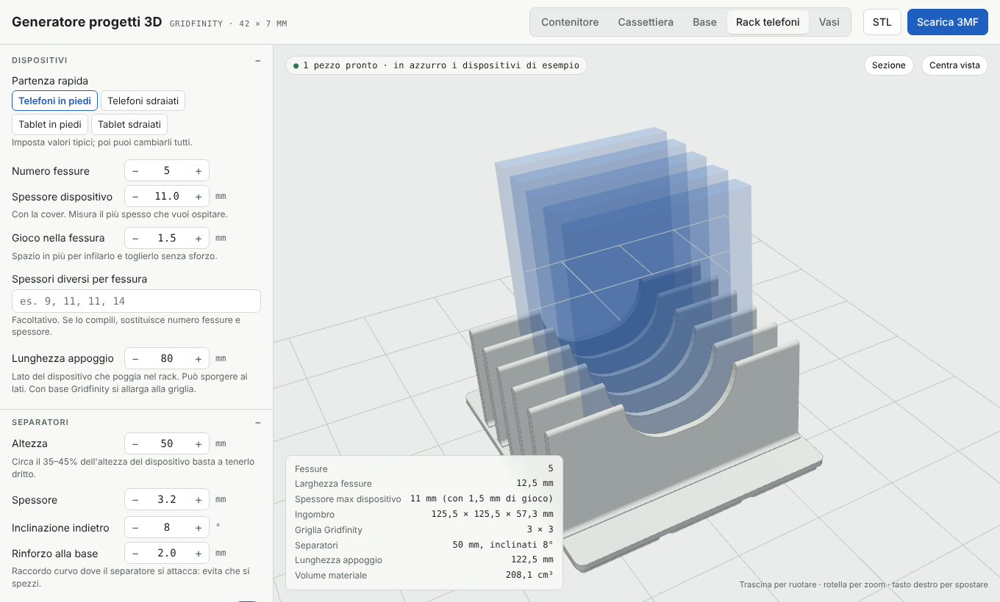
- Partenza rapida: telefoni o tablet, in piedi o sdraiati. Poi cambi tutto.
- Numero di fessure, spessore del dispositivo (con la cover) e gioco.
- Spessori diversi per ogni fessura, per esempio `9, 11, 11, 14`.
- Separatori con altezza, spessore e inclinazione regolabili, tacca per le dita e rinforzo curvo alla base.
- Base Gridfinity oppure libera, con incavi per piedini in gomma.
- Orientamento di stampa *in piedi* o *sul fianco*. Sul fianco i separatori sono molto più robusti.
- Nell'anteprima vedi dei dispositivi di esempio in azzurro, che non finiscono nel file.

### Vasi
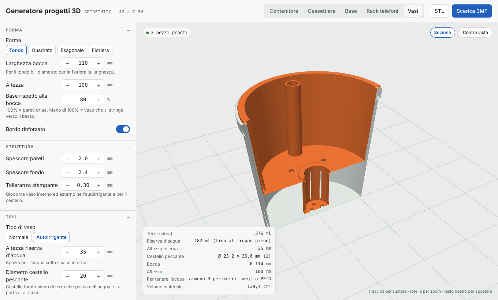
- **Forme:** tondo, quadrato, esagonale, oppure fioriera rettangolare con scomparti (una pianta per scomparto).
- **Misure:** bocca, altezza, quanto si stringe verso il basso, bordo rinforzato.
- **Vaso normale:** fori di drenaggio, canali di scolo sotto il fondo, sottovaso con rialzi.
- **Vaso autoirrigante:**
  - vaso esterno come riserva d'acqua, con foro di troppo pieno;
  - vaso interno che si appoggia sul bordo, con tubo per riempire;
  - cestello pescante forato, separato, che porta l'acqua alle radici.
- Il programma calcola **litri di terra** e **millilitri di riserva d'acqua**.

### Reggimensole e ganci
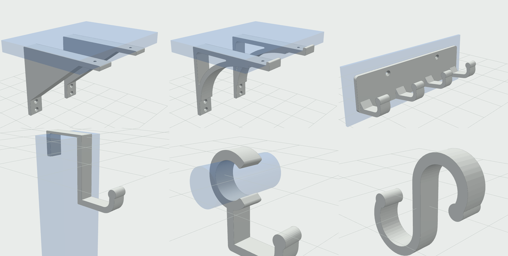
Si stampano **sdraiati sul fianco**: gli strati seguono il profilo, così la squadra non si apre e il gancio non si spezza lungo gli strati.

- **Reggimensola:**
  - profondità (sotto la mensola), altezza sul muro, larghezza e spessore;
  - rinforzo a scelta: triangolo pieno (il più robusto), triangolo traforato, puntone diagonale, raccordo curvo, arco, oppure nessuno (squadra a L); l'*estensione* dice quanta parte dei bracci copre;
  - viti al muro e sotto la mensola, diametro e svasatura. I fori vanno solo dove arriva il cacciavite (non dietro il rinforzo): se non c'è spazio il riquadro misure lo dice. Fori a goccia, stampabili senza supporti;
  - *labbro* in punta che non fa scivolare la mensola (comodo per il vetro);
  - numero di copie; nell'anteprima c'è una mensola d'esempio in azzurro.
- **Gancio:**
  - *a muro*: uno o più ganci (appendiabiti) con la distanza tra loro, su una piastra fissata con viti (sopra i ganci, dove arriva il cacciavite), biadesivo o magneti incassati sul retro;
  - *sopra porta o anta*: si aggancia sul bordo della porta; imposti spessore della porta, il ponte sottile che passa nella fessura del telaio e la lunghezza dei due lati;
  - *per tubo o bastone*: anello a scatto sul tubo (diametro e apertura regolabili) e gancio sotto;
  - *a S*: apertura sopra e sotto e lunghezza del gambo;
  - per tutti: larghezza e spessore del gancio, sporgenza, raggio della curva, altezza della punta, inclinazione e pallino in punta;
  - orientamento di stampa sul fianco (robusto) o sulla schiena (comodo per gli appendiabiti lunghi).

### Viti e bulloni
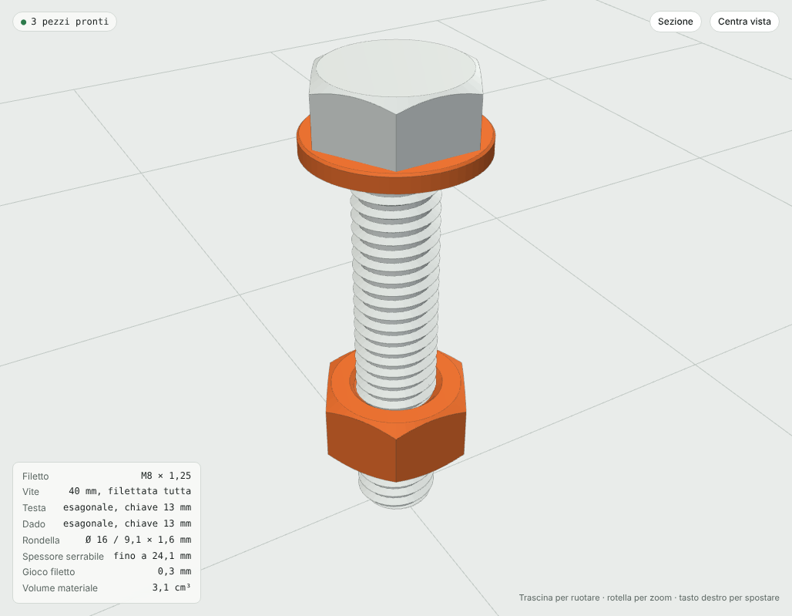
- **Filetto metrico ISO** a passo grosso, da M3 a M30; con *Altro* scegli diametro e passo liberi. Filetto destro o sinistro.
- Il filetto è un'elica vera, non un'approssimazione: vite e dado dello stesso file si avvitano.
- **Gioco filetto** regolabile (0,3 mm all'inizio): è lo spazio tra i fianchi di vite e dado.
- **Lunghezza filettata**: tutta, oppure solo in punta con il resto del gambo liscio.
- **Teste:** esagonale, cilindrica, svasata a 90°, zigrinata da girare a mano, oppure senza testa (grano o barra filettata). Impronta a esagono incassato o a taglio. Le misure della testa sono quelle standard ISO, oppure le scegli tu con *Misure testa su misura* (larghezza o chiave, e altezza).
- **Bullone:** dado esagonale, zigrinato o ad alette, dado alto (×1,5) e da zero a due rondelle. L'anteprima mostra il bullone montato e lo spessore che puoi serrare.
- **Orientamento di stampa:** *in piedi* (testa in basso, filetto più preciso) o *sdraiata*, con un lato piatto per appoggiarla: molto più resistente.

### Perni
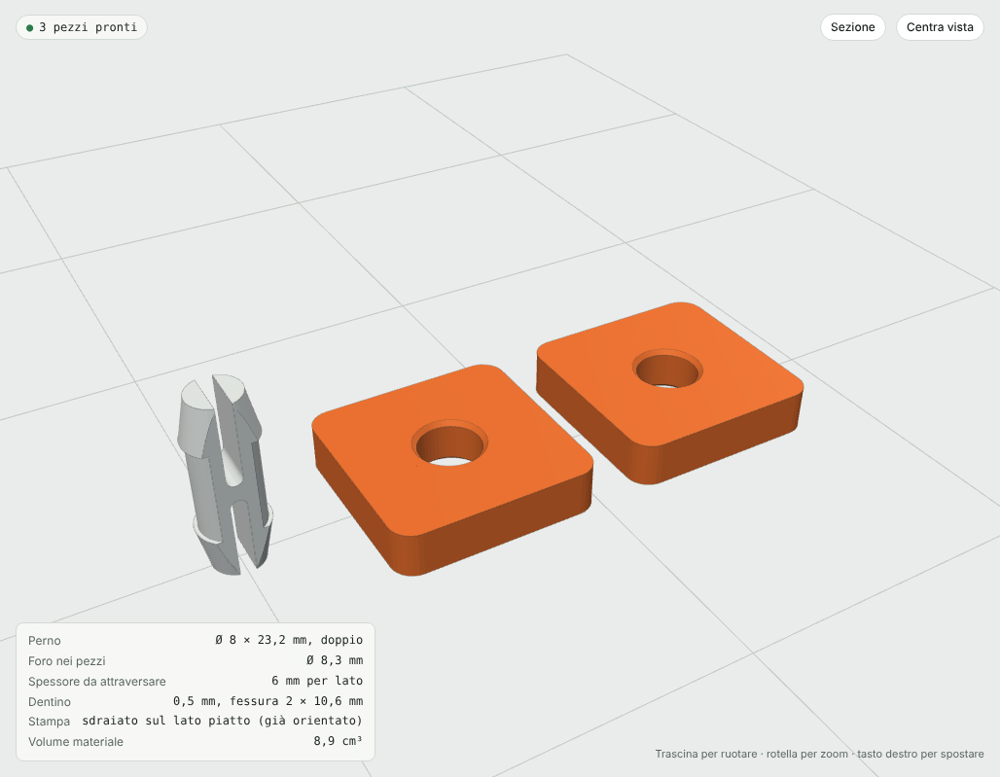
- **A scatto:** si infila nel foro e si aggancia da solo con due dentini elastici. Doppio, per unire due pezzi, oppure con testa. Imposti diametro e spessore del pezzo da attraversare; il file è già orientato sdraiato sul lato piatto.
- **Spina liscia** con estremità smussate, per centrare due pezzi.
- **Con testa**, con foro per la coppiglia: per cerniere e snodi.
- Il riquadro misure indica il **foro da fare nei tuoi pezzi** (diametro + tolleranza).
- **Piastrina di prova:** un pezzetto con il foro giusto, per provare l'incastro prima di stampare il progetto vero.

---

## Come si usa

1. Scarica `index.html` e aprilo con un browser (Chrome, Safari, Firefox, Edge). Funziona anche offline.
2. Nella pagina iniziale scegli cosa generare. Con Gridfinity, in alto passi da contenitore a cassettiera a base. **← Tutti** riporta alla pagina iniziale.
3. A sinistra regoli i parametri: l'anteprima si aggiorna subito.
4. Nel riquadro in basso leggi le misure reali (esterno, interno, volumi, avvisi).
5. Premi **Scarica 3MF**, oppure **STL**, e apri il file nello slicer.

**Comandi dell'anteprima**
- Trascina per ruotare, rotella per lo zoom, tasto destro per spostare.
- **Sezione** taglia il modello a metà per vedere com'è fatto dentro.
- **Centra vista** riporta la camera sul modello.

I valori che imposti restano salvati nel browser. **Ripristina valori** torna a quelli iniziali.

**Link diretti:** ogni generatore ha il suo indirizzo, da usare per linkarlo o salvarlo nei preferiti: `#natale` (pallina), `#natale-palla` (palla piatta), `#natale-piatto`, `#natale-albero`, `#natale-stella`, `#natale-lanterna`, `#natale-formina`, `#gridfinity`, `#gridfinity-cab` (cassettiera), `#gridfinity-base`, `#rack`, `#vasi`, `#supporti` (reggimensola), `#supporti-gancio`, `#viteria` (vite), `#viteria-bullone`, `#viteria-perno`.

### Il file 3MF
- Ogni pezzo è un oggetto separato e con il suo nome (per esempio "Cassetto 3" o "Cestello pescante 1").
- Le parti di colori diversi dello stesso pezzo restano unite in un solo oggetto multicolore.
- I pezzi sono già disposti sul piatto e orientati per la stampa senza supporti: coperchi e cestelli capovolti, cassetti accanto al mobile, viti con la testa in basso o sdraiate sul lato piatto, dadi e rondelle accanto.
- Funziona con Bambu Studio, PrusaSlicer, OrcaSlicer, Cura e gli altri slicer che leggono il 3MF.

---

## Consigli di stampa

### Tarare la tolleranza
Ogni stampante è diversa. Il parametro **Tolleranza stampante** (0,3 mm all'inizio) è il gioco usato negli incastri: cassetti, fori per magneti, vaso interno e cestello.
1. Stampa un pezzo piccolo, per esempio una cassettiera 1×2 con un cassetto.
2. Se il cassetto entra troppo stretto, aumenta la tolleranza di 0,05–0,1 mm.
3. Se balla troppo, diminuiscila.

### Per tipo di oggetto
- **Decorazioni piatte e palle piatte:** strati da 0,2 mm, 3 mm di spessore. Spessore, spessore della scritta e rilievo vanno a multipli di 0,2 e di 0,28 mm (0,28 · 0,56 · 0,84 · 1,12…): con − e + si passa al valore vicino, così ogni colore cade su strati interi anche se stampi il primo strato a 0,28. Per scritte piccole ugello da 0,4 mm e lettere di almeno 5 mm. La scritta in corsivo regge meglio se è almeno 8 mm.
- **Palline:** incolla le due metà sull'anello con colla cianoacrilica. Lo spessore del guscio va bene da 1,2 mm in su; con 0,8 mm la pallina è leggerissima ma delicata.
- **Formine:** usa PLA o PETG adatti agli alimenti e lavale a mano.
- **Lanterne:** solo lumini LED, mai candele vere.
- **Gridfinity:** per la prima prova stampa un contenitore 1×1×3 e una base 2×2, così verifichi incastro e impilamento.
- **Pareti:** usa spessori multipli del diametro dell'ugello (con 0,4 mm: 0,8, 1,2, 1,6).
- **Rack:** se i separatori sono alti o sottili, stampalo *sul fianco*.
- **Vasi:** perché tengano l'acqua servono almeno 3 perimetri. Per il vaso esterno dell'autoirrigante e per il sottovaso, il PETG è meglio del PLA.
- **Reggimensole e ganci:** lasciali sul fianco come escono dal file. 4 o più perimetri e riempimento 40% o più; per pesi veri PETG. Per libri usa squadre da 7 mm di spessore e 25 mm di larghezza in su, con il rinforzo a triangolo pieno.
- **Viti e bulloni:** stampa prima un bullone M8 corto per tarare il *Gioco filetto*. Usa 4 o più perimetri (o riempimento 100%) e strati sottili (0,12–0,16 mm). Sotto M6 il filetto stampato è delicato. Per viti che lavorano, PETG o nylon.
- **Perni a scatto:** se il perno entra troppo duro aumenta la tolleranza; se la fessura è corta (lo segnala il riquadro misure) il perno resta rigido.

---

## Per sviluppatori

### Struttura

```
├── index.html      pagina finale (generata, non modificarla a mano)
├── build.py        unisce sorgenti e librerie in index.html
├── package.json    librerie: three.js e manifold-3d
├── src/
│   ├── page.html   interfaccia e stili
│   ├── app.js      parametri, anteprima 3D, esportazione 3MF/STL
│   ├── geom.js     geometria dei generatori (filetti compresi)
│   ├── natale.js   generatori di Natale: forme, scritte, colori
│   ├── supporti.js reggimensole e ganci
│   ├── fonts.js    contorni dei caratteri (generato)
│   ├── logos.js    contorni dei loghi per le scritte (generato da assets/)
│   ├── svg.js      lettore SVG (disegni caricati e libreria)
│   └── emoji.js    disegni Fluent Emoji (generato)
├── assets/         loghi: SVG per la pagina (li incorpora build.py) e STL originali
├── tools/
│   ├── make-fonts.mjs  rigenera src/fonts.js dai caratteri
│   ├── make-logos.mjs  rigenera src/logos.js dagli STL dei loghi
│   └── make-emoji.mjs  rigenera src/emoji.js dai Fluent Emoji
└── docs/img/       immagini per questo README
```

### Ricostruire `index.html`

```bash
npm install
python3 build.py
```

Lo script incorpora three.js, Manifold (compreso il file WebAssembly), i caratteri e i sorgenti in un solo HTML da circa 1,8 MB, che funziona offline.

Per cambiare i caratteri delle scritte modifica l'elenco in `tools/make-fonts.mjs` e lancia `npm run fonts`. Per cambiare i loghi sostituisci gli STL e gli SVG in `assets/` e lancia `npm run logos`. Per aggiungere o togliere disegni dalla libreria modifica l'elenco in `tools/make-emoji.mjs` e lancia `npm run emoji`.

### Come funziona
- **Geometria:** [Manifold](https://github.com/elalish/manifold) (WebAssembly) costruisce solidi con operazioni booleane. I modelli escono sempre chiusi e senza errori.
- **Scritte:** i contorni dei caratteri sono salvati in `src/fonts.js`; al momento le curve diventano poligoni e poi solidi.
- **Colori:** un generatore può dare a ogni parte un `color` e un `group`. Le parti dello stesso gruppo diventano un solo oggetto con più parti (componenti 3MF), e i colori finiscono nei materiali del file.
- **Filetti:** la sezione trasversale del profilo ISO a 60° viene estrusa con una torsione di 360° per ogni passo, e ne esce un'elica esatta. Il foro del dado usa la stessa sezione allargata del gioco, con la stessa fase: per questo vite e dado combaciano.
- **Anteprima:** [three.js](https://threejs.org/).
- **Esportazione:** il 3MF è un file zip con dentro XML, scritto direttamente dal codice senza librerie esterne.

### Aggiungere un generatore
1. In `src/geom.js` scrivi una funzione `nome(p)` che riceve i parametri e restituisce quanto segue. Per un gruppo grande puoi usare un file a parte che si registra in `SPRECOLO_EXT`, come `src/natale.js`, e aggiungerlo a `build.py`.
   - `parts`: lista di `{ name, m, role, print?, at?, color?, group? }`
     - `m` è il solido Manifold;
     - `print` è la versione già orientata per la stampa;
     - `at` è la posizione nell'anteprima;
     - `role: 'ghost'` indica un oggetto solo di esempio, che non viene esportato.
     - `color` (es. `'#b3202a'`) e `group`: le parti con lo stesso gruppo diventano un unico oggetto multicolore.
   - `info`: lista di coppie `[etichetta, valore]` per il riquadro delle misure.
2. Collegala in `build()` dentro `geom.js`.
3. In `src/app.js` aggiungi una voce in `MODES` con l'elenco dei parametri: tipo `int`, `num`, `bool`, `select` o `text`, con `min`, `max`, `step`, `def`, `unit`, `help` e `show`.
4. Sempre in `src/app.js`, aggiungi il generatore a `GROUPS`: un nuovo gruppo diventa un nuovo riquadro nella pagina iniziale, con titolo, categoria e descrizione. Puoi anche aggiungerlo a un gruppo esistente, che mostra le sotto-schede in alto. L'anteprima del riquadro viene generata in automatico dal motore.
5. Esegui `python3 build.py`.

---

## Crediti

- **Gridfinity**, il sistema modulare creato da [Zack Freedman](https://www.youtube.com/@ZackFreedman). SP Lab ne riproduce le misure standard.
- **[three.js](https://github.com/mrdoob/three.js)**, licenza MIT.
- **[Manifold](https://github.com/elalish/manifold)**, licenza Apache 2.0.
- Caratteri **IBM Plex**, licenza SIL Open Font License (caricati da Google Fonts quando c'è connessione).
- Caratteri delle scritte **Fredoka**, **Pacifico** e **Mountains of Christmas**, licenza SIL Open Font License, incorporati nella pagina.

- Disegni **[Fluent Emoji](https://github.com/microsoft/fluentui-emoji)** © Microsoft Corporation, licenza MIT (testo completo in [LICENSE-fluent-emoji.txt](LICENSE-fluent-emoji.txt), riportato anche dentro la pagina).
- Loghi **SP** e ritratto © Procolo Carannante.

## Licenza

Distribuito con licenza [MIT](LICENSE) © 2026 Procolo Carannante: chiunque può usare e modificare il progetto citando l'autore.

## Sito pubblico

Il generatore è online su **https://procolo75.github.io/sp-lab/**
